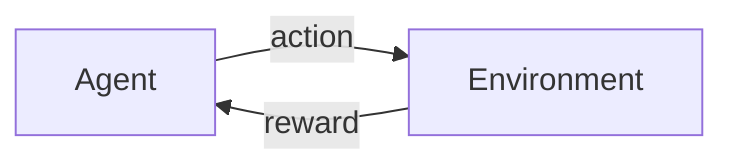
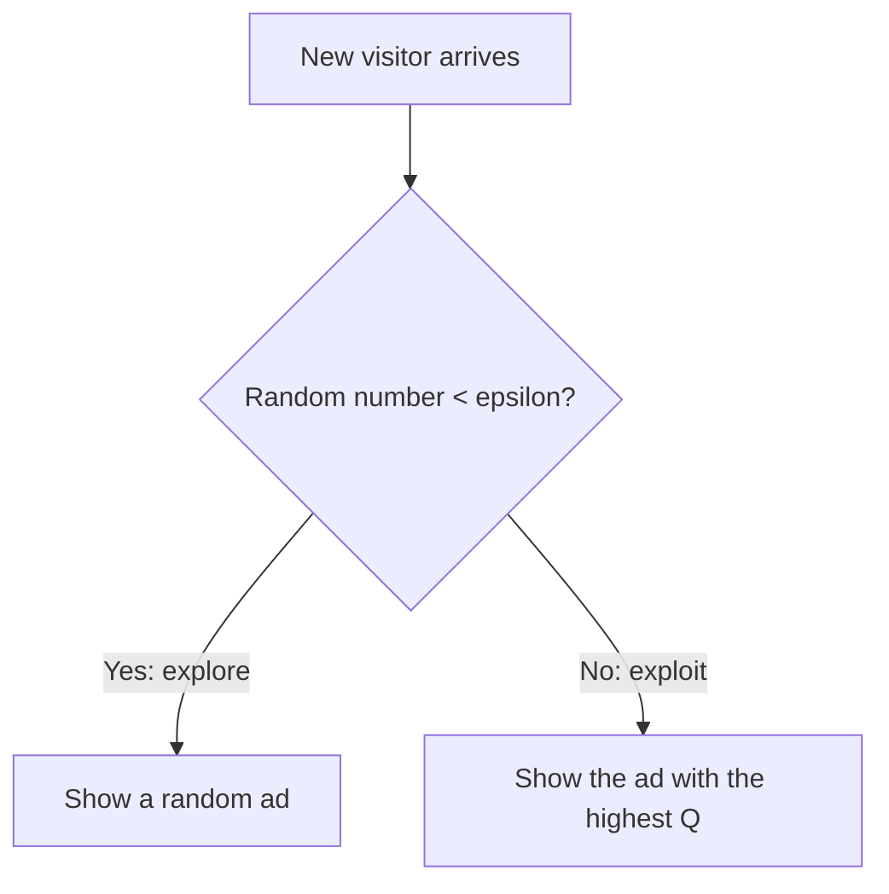

# Multi-Armed Bandit: A Complete Guide

*Part of the ML Repo (Reinforcement Learning). Code: [`Multi_Armed_Bandit.ipynb`](Multi_Armed_Bandit.ipynb)*

## Table of Contents
1. [What is Reinforcement Learning?](#1-what-is-reinforcement-learning)
2. [The Problem: Which Ad Should We Show?](#2-the-problem-which-ad-should-we-show)
3. [Exploration vs Exploitation](#3-exploration-vs-exploitation)
4. [The Environment](#4-the-environment)
5. [The Agent: Epsilon-Greedy](#5-the-agent-epsilon-greedy)
6. [One Experiment: Inside the Agent](#6-one-experiment-inside-the-agent)
7. [Comparing Strategies](#7-comparing-strategies)
8. [Decaying Epsilon](#8-decaying-epsilon)
9. [Regret: The Cost of Learning](#9-regret-the-cost-of-learning)
10. [Final Results](#10-final-results)
11. [Conclusions and Limitations](#11-conclusions-and-limitations)
12. [Next Steps](#12-next-steps)
13. [How to Run](#13-how-to-run)
14. [Glossary](#14-glossary)

---

## 1. What is Reinforcement Learning?

In **Reinforcement Learning (RL)** there is no labelled dataset. An **agent** learns by *trying actions* in an **environment** and receiving a **reward** after each action. Over time it learns which actions earn the most reward.



| Term | Meaning | In this project |
|---|---|---|
| **Agent** | The learner that makes decisions | The ad-selection algorithm |
| **Environment** | Everything the agent interacts with | The website and its visitors |
| **Action** | A choice the agent can make | Which ad to show |
| **Reward** | Feedback after an action | 1 if the visitor clicks, 0 if not |
| **Policy** | The agent's strategy for choosing actions | The epsilon-greedy rule |

### How is RL different from the other categories?

| | Supervised | Unsupervised | Reinforcement |
|---|---|---|---|
| Data | Inputs with correct answers (labels) | Inputs only | No dataset: data comes from interaction |
| Goal | Predict the label | Find hidden structure | Maximize total reward |
| Feedback | Correct answer for every example | None | Reward, often delayed and noisy |
| Example in this repo | Loan Approval | Mall Customer Segmentation | **Multi-Armed Bandit** |

## 2. The Problem: Which Ad Should We Show?

Imagine a website with **5 different ads**. Each ad has a true click-through rate (CTR), but **nobody knows these rates**. Every time we show an ad we only see whether the visitor clicked (reward 1) or not (reward 0).

This is the **Multi-Armed Bandit** problem. The name comes from a gambler facing a row of slot machines ("one-armed bandits") with unknown payout rates, who must decide which machine to play.

In our experiment the hidden CTRs are:

| Ad | Hidden CTR |
|---|---|
| Ad 0 | 0.05 |
| Ad 1 | 0.10 |
| **Ad 2** | **0.20 (best)** |
| Ad 3 | 0.08 |
| Ad 4 | 0.15 |

The agent never sees this table. We keep it only to measure how well the agent did.

## 3. Exploration vs Exploitation

This is the central idea of all RL.

- **Exploit:** show the ad that looks best so far (earn reward now).
- **Explore:** try other ads to check whether one of them is actually better (learn for the future).

Too much exploitation can lock the agent onto a mediocre ad. Too much exploration wastes impressions on bad ads. A good algorithm balances both.

## 4. The Environment

The environment is a **Bernoulli bandit**. When the agent pulls an arm (shows an ad), the environment returns **1** with probability equal to that ad's CTR, and **0** otherwise.

```python
class BernoulliBandit:
    def __init__(self, true_ctr, rng):
        self.true_ctr = np.array(true_ctr)
        self.n_arms = len(true_ctr)
        self.best_arm = int(np.argmax(self.true_ctr))
        self.rng = rng

    def pull(self, arm):
        return float(self.rng.random() < self.true_ctr[arm])
```

## 5. The Agent: Epsilon-Greedy

The agent keeps two arrays:
- `Q`: its **estimate** of each ad's click rate
- `N`: how many times each ad has been shown

### The policy (how it chooses)



- With probability **epsilon**, pick a **random** ad (explore).
- With probability **1 - epsilon**, pick the ad with the **highest Q** (exploit).
- If several ads tie for the highest `Q`, pick one of them at random.

### The learning rule (how it updates)

After showing ad `a` and seeing reward `R`, the agent moves its estimate a little toward the new observation:

$$Q_{n+1} = Q_n + \frac{1}{n}\,(R - Q_n)$$

- `(R - Q_n)` is the **error**: what happened compared to what the agent expected.
- `1/n` makes updates smaller as more evidence is collected.
- The result is exactly the **running average** of all rewards for that ad, but computed without storing every past reward.

**Example:** an ad has `Q = 0.20` after 4 shows. It is shown a 5th time and gets a click (`R = 1`). The new estimate is `0.20 + (1/5) x (1 - 0.20) = 0.36`.

### Fixed vs decaying epsilon

`epsilon` can be a fixed number or a function of time. The same agent class supports both.

## 6. One Experiment: Inside the Agent

We run the agent for 1,000 visitors with `epsilon = 0.1` and compare what it *believes* with the truth.

| Ad | True CTR | Agent's estimate | Times shown |
|---|---|---|---|
| Ad 0 | 0.05 | 0.063 | 16 |
| Ad 1 | 0.10 | 0.000 | 21 |
| **Ad 2** | **0.20** | **0.199** | **919** |
| Ad 3 | 0.08 | 0.130 | 23 |
| Ad 4 | 0.15 | 0.143 | 21 |

The agent earned 190 clicks from 1,000 visitors (CTR 0.190) while the best possible was 0.200.


**How to read this:**
- The agent found the best ad and showed it most of the time. The other impressions are the **price of exploration**.
- Estimates of rarely shown ads are **unreliable**. Ad 1 was shown only 21 times and is estimated at 0.000, although its true CTR is 0.10. Each estimate is an average of few observations, so it can be far from the truth.

## 7. Comparing Strategies

One run is noisy because luck matters. To compare strategies fairly, we repeat the experiment **300 times** (1,500 visitors each) and average the results.

| Strategy | epsilon | Behaviour |
|---|---|---|
| Random | 1.0 | Always explores, never uses what it learned |
| Greedy | 0.0 | Never explores, may lock onto a bad ad early |
| Epsilon-greedy | 0.01 | Rarely explores, learns slowly |
| Epsilon-greedy | 0.1 | A balanced choice |
| Epsilon-greedy | 0.3 | Explores a lot |

Three things are tracked at every step, averaged over all runs:
- **Average reward:** clicks per visitor.
- **% optimal action:** how often the agent showed the truly best ad.
- **Regret:** expected clicks lost per visitor compared to always showing the best ad (see section 9).


**How to read the graphs:**
- **Random** stays flat at the average CTR of all ads (about 0.12). It never learns.
- **Greedy** learns quickly at first, but in most runs it locks onto the first ad that happened to give a click. Its curve flattens, and it shows the best ad in only about 36% of cases.
- **Epsilon 0.01** is slow because it hardly explores, but it keeps improving.
- **Epsilon 0.3** learns quickly but is capped, because it keeps spending 30% of the impressions on random ads even after the best ad is known.
- **Epsilon 0.1** is a good middle ground.

## 8. Decaying Epsilon

A fixed epsilon explores forever, even when the agent already knows the best ad. A smarter idea is to **start with a high epsilon and reduce it over time**:

```
epsilon(t) = max(0.01, 0.995 ** t)
```

Early on, the agent explores almost always (epsilon near 1). As it gains experience it explores less and less, down to a minimum of 1%.


## 9. Regret: The Cost of Learning

**Regret** at a step = (CTR of the best ad) minus (CTR of the ad we showed). If we show the best ad, regret is 0.

**Cumulative regret** adds this up over time. It tells us how many expected clicks we lost while learning.

- A good algorithm has a cumulative regret curve that **flattens**, because it stops losing.
- A bad algorithm keeps losing at a constant rate, so its curve is a rising straight line.


## 10. Final Results

Measured over the last 500 steps (after learning has settled) and over all 1,500 steps for regret. Settings: `SEED = 42`, 300 runs.

| Strategy | Avg reward (last 500) | % optimal ad (last 500) | Total regret |
|---|---|---|---|
| **Decaying epsilon** | **0.193** | **86.3%** | **30.8** |
| Epsilon 0.1 | 0.184 | 76.7% | 36.3 |
| Epsilon 0.3 | 0.172 | 69.5% | 51.3 |
| Epsilon 0.01 | 0.165 | 54.3% | 64.3 |
| Greedy (eps = 0) | 0.143 | 36.0% | 86.5 |
| Random (eps = 1) | 0.116 | 20.0% | 125.8 |

The best possible average reward is 0.200. Another seed gives slightly different numbers, but the same ordering.

## 11. Conclusions and Limitations

1. **Exploration is necessary.** Pure greedy never explores. Its regret was about 86 expected clicks lost, compared to about 36 for `epsilon = 0.1`.
2. **Too much exploration costs clicks.** Random (regret about 126) never uses what it learned. Even `epsilon = 0.3` wastes 30% of impressions on random ads after the best one is known (regret about 51).
3. **Too little exploration is slow.** `epsilon = 0.01` is still improving at step 1,500 (regret about 64).
4. **Decaying epsilon is the best here.** It explores a lot early and exploits later. It has the lowest regret (about 31) and earns 0.193 against the best possible 0.200.
5. **Estimates of rarely shown ads are unreliable.** The agent needs enough exploration before it can trust an estimate.

### What we learned about RL
- The agent learns **only from rewards**, never from correct answers.
- **Exploration vs exploitation** is the core trade-off of the whole field.
- RL agents are judged by **cumulative reward** (or regret), not by accuracy.

### Limitations of this model
- There is **no state**: the situation is the same at every step.
- The agent's actions **do not change the environment**.
- Click rates **never change**. Real ad rates drift over time, so real systems use a constant step size instead of `1/n`, or more advanced algorithms.

## 12. Next Steps

1. Try other bandit algorithms on the same environment: **UCB** and **Thompson Sampling**.
2. Move to **Q-Learning on FrozenLake**. There the agent has **states** and its actions change the next state, which is the real RL problem. It uses the same idea as this guide (a table of values updated from rewards).

## 13. How to Run

```bash
pip install numpy matplotlib pandas jupyter
jupyter notebook Multi_Armed_Bandit.ipynb
```

Running the notebook creates an `images/` folder with the four graphs used in this guide.

Suggested repo location:

```
reinforcement_learning/
└── 01_multi_armed_bandit/
    ├── Multi_Armed_Bandit.ipynb
    ├── Multi_Armed_Bandit_Guide.md
    └── images/
```

## 14. Glossary

| Term | Simple meaning |
|---|---|
| Agent | The decision-maker that learns |
| Environment | The world the agent acts in |
| Action / arm | A choice the agent can make (an ad to show) |
| Reward | Feedback after an action (1 = click, 0 = no click) |
| Policy | The rule the agent uses to choose actions |
| Exploration | Trying actions to gain information |
| Exploitation | Choosing the action that currently looks best |
| Epsilon | The probability of exploring |
| Q value | The agent's estimate of an action's average reward |
| CTR | Click-through rate: clicks divided by impressions |
| Regret | Reward lost compared to always choosing the best action |
| Bernoulli bandit | A bandit whose reward is 1 or 0 with a fixed probability |
