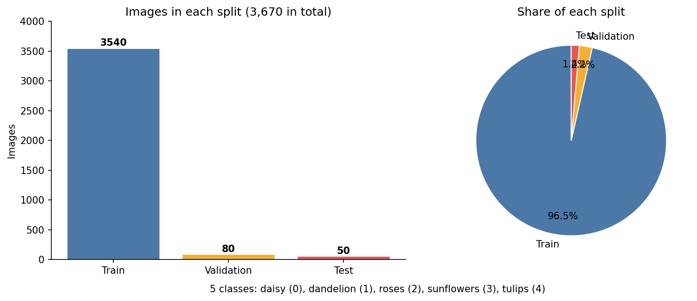
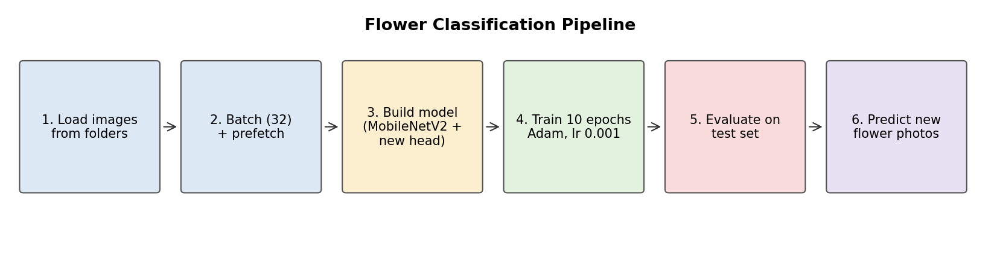
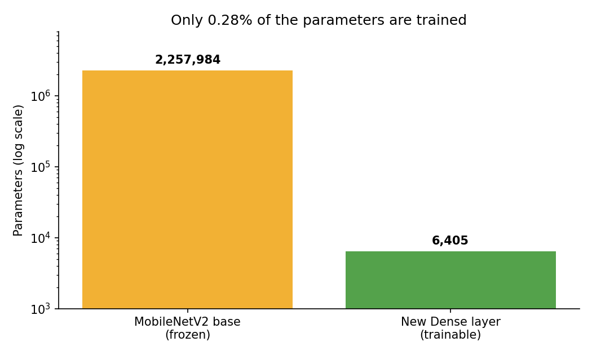
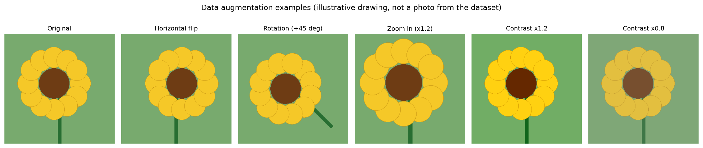
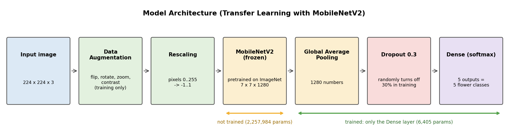
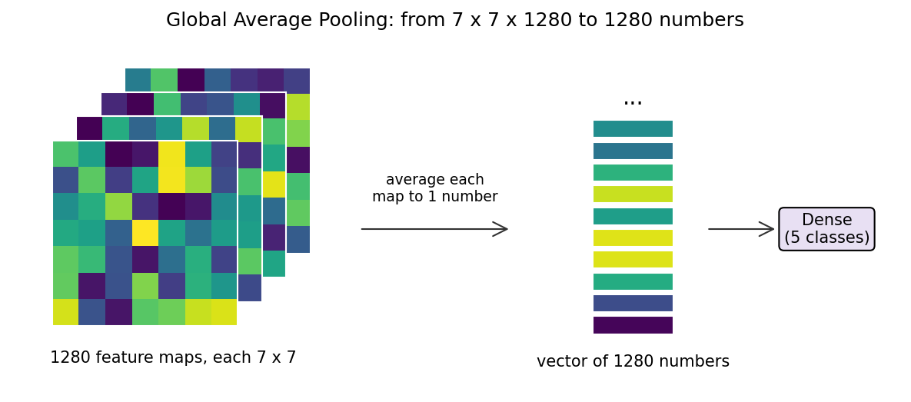
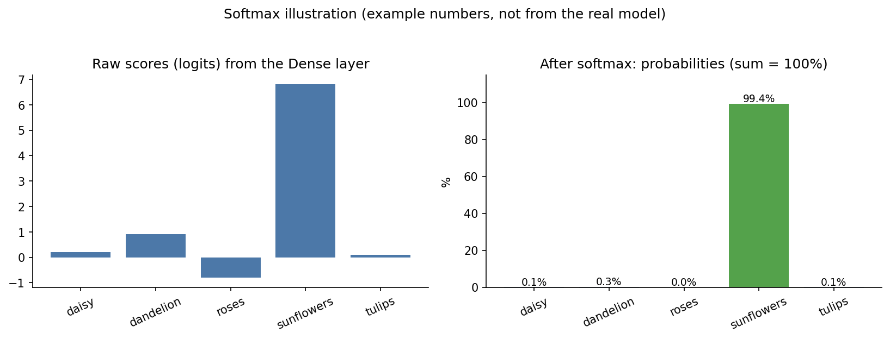
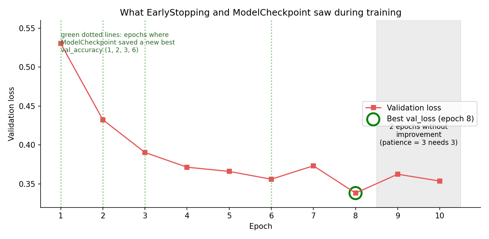
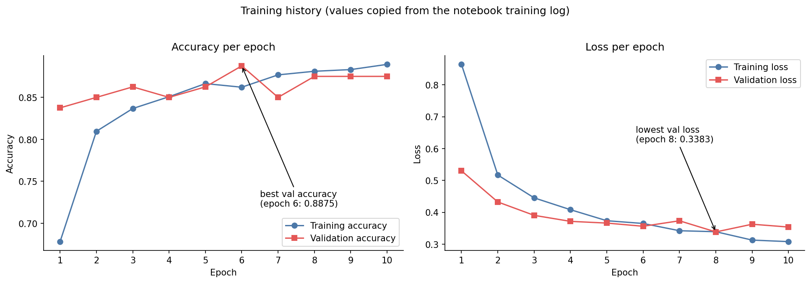
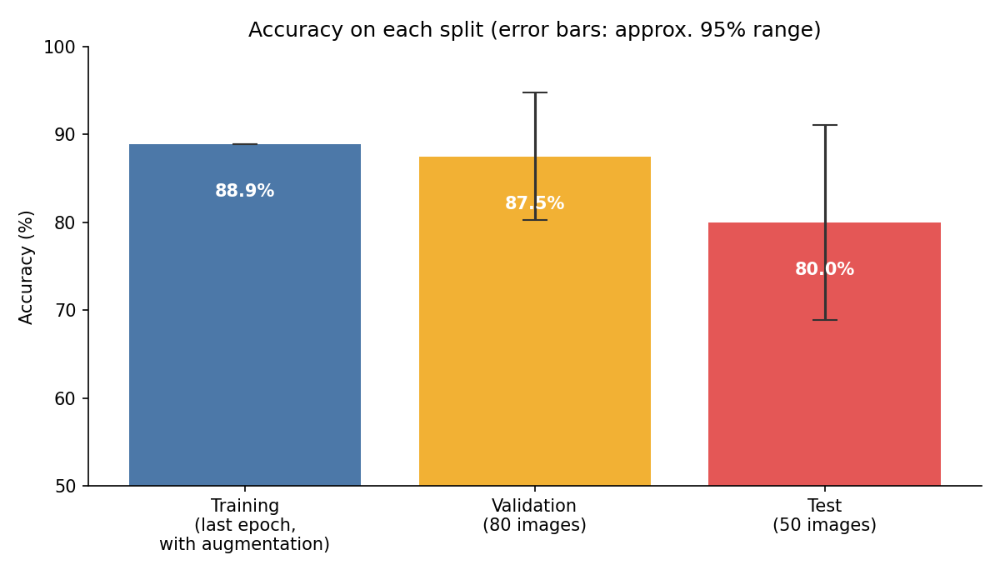

# Flower Classification using Transfer Learning (MobileNetV2)

A deep learning project that looks at a photo of a flower and tells which of **5 flower types** it is: daisy, dandelion, roses, sunflowers or tulips. Instead of training a neural network from zero, the project reuses **MobileNetV2**, a network that was already trained on millions of images, and trains only a small new classification layer on top of it. This technique is called **transfer learning**.

**Results (from the notebook):** Validation accuracy 87.5%, Test accuracy 80.0%. A test photo of a sunflower was predicted correctly with 99.87% confidence.

---

## Table of Contents

1. [Problem Statement](#1-problem-statement)
2. [Dataset](#2-dataset)
3. [Project Pipeline](#3-project-pipeline)
4. [Key Concepts](#4-key-concepts)
5. [Loading the Data](#5-loading-the-data)
6. [Data Augmentation](#6-data-augmentation)
7. [Model Architecture](#7-model-architecture)
8. [Compiling the Model](#8-compiling-the-model)
9. [Callbacks: EarlyStopping and ModelCheckpoint](#9-callbacks-earlystopping-and-modelcheckpoint)
10. [Training](#10-training)
11. [Evaluation](#11-evaluation)
12. [Predicting a New Image](#12-predicting-a-new-image)
13. [Strengths and Limitations](#13-strengths-and-limitations)
14. [Notes on the Notebook](#14-notes-on-the-notebook)
15. [Suggested Improvements](#15-suggested-improvements)
16. [How to Run](#16-how-to-run)

---

## 1. Problem Statement

Given a photo of a flower, predict its type.

- **Type of problem:** supervised learning, **multi-class image classification**
- **Input:** a color image, resized to 224 x 224 pixels
- **Output:** one of 5 classes, together with a probability for each class

---

## 2. Dataset

The images are stored in folders, one folder per class:

```
flower_photos/
├── train/        (3,540 images)
├── validation/   (80 images)
└── test/         (50 images)
```

Each of these folders contains 5 sub-folders: `daisy`, `dandelion`, `roses`, `sunflowers` and `tulips`. The folder name is used as the label.

| Split | Images | Purpose |
|---|---|---|
| Train | 3,540 | The model learns from these |
| Validation | 80 | Checked after every epoch to watch for overfitting and to choose the best epoch |
| Test | 50 | Final, unbiased check after training |



The three splits add up to 3,670 images, which matches the size of the well-known TensorFlow Flowers dataset (5 classes). The classes are numbered alphabetically: daisy = 0, dandelion = 1, roses = 2, sunflowers = 3, tulips = 4.

---

## 3. Project Pipeline



1. Load images from folders into TensorFlow datasets
2. Group them into batches of 32 and prefetch for speed
3. Build the model: pretrained MobileNetV2 plus a new classification head
4. Train for up to 10 epochs with the Adam optimizer
5. Evaluate on the test set
6. Predict the class of a new photo

---

## 4. Key Concepts

### 4.1 Convolutional Neural Networks (CNN)

A CNN is a neural network designed for images. It slides small filters over the image to detect patterns:

- the **first layers** detect simple things such as edges, lines and colors,
- the **middle layers** combine them into shapes such as curves and textures (petal edges, leaf patterns),
- the **deep layers** recognize whole parts and objects (a flower center, a petal arrangement).

A CNN learns these filters automatically from the data.

### 4.2 Transfer Learning

Training a deep CNN from scratch needs a huge number of images and a lot of computing time. Transfer learning avoids this:

1. Take a network (here MobileNetV2) that was already trained on **ImageNet**, a dataset with over a million images in 1,000 categories.
2. Keep its layers, which already know how to see edges, textures and shapes.
3. Remove its original 1,000-class output layer (`include_top=False`).
4. Add a small new layer for your own 5 classes and train only that layer.

This works well even with a few thousand images and trains quickly on a normal laptop CPU.

### 4.3 MobileNetV2

MobileNetV2 is a lightweight CNN designed to be fast and small enough for phones and edge devices. It uses **depthwise separable convolutions** (a cheaper way to apply filters) and **inverted residual blocks with shortcut connections**. For a 224 x 224 x 3 input, the part used here outputs a **7 x 7 x 1280** feature map and has **2,257,984 parameters**.

### 4.4 Freezing layers

`base_Model.trainable = False` freezes the MobileNetV2 weights, so they are not changed during training. Only the new layer on top learns. This keeps the good ImageNet knowledge intact and makes training fast.



---

## 5. Loading the Data

```python
train_data = tf.keras.utils.image_dataset_from_directory(
    train_dir, image_size=IMG_size, batch_size=BATCH_size, shuffle=True
)
```

What this function does:

- reads every image from the folder and uses the sub-folder name as its label,
- **resizes** each image to 224 x 224, the input size expected by MobileNetV2,
- groups the images into **batches of 32**,
- returns the labels as integers (0 to 4).

| Setting | Value | Reason |
|---|---|---|
| `shuffle=True` for train | mixes the order every epoch | Prevents the model from learning the order of the data |
| `shuffle=False` for validation/test | fixed order | Results are consistent and repeatable |
| `batch_size=32` | 32 images per step | A good balance between speed and memory. 3,540 images give 111 steps per epoch |

**Prefetching:**

```python
train_data = train_data.prefetch(tf.data.AUTOTUNE)
```

While the model is working on the current batch, TensorFlow already prepares the next one in the background. This reduces waiting time.

---

## 6. Data Augmentation

With only about 3,500 training images, a network could memorize them. Data augmentation creates slightly changed versions of the images **on the fly**, so the model sees more variety.

```python
data_augmentation = tf.keras.Sequential([
    layers.RandomFlip("horizontal"),
    layers.RandomRotation(0.2),
    layers.RandomZoom(0.2),
    layers.RandomContrast(0.2)
])
```

| Layer | What it does |
|---|---|
| `RandomFlip("horizontal")` | Randomly mirrors the image left to right |
| `RandomRotation(0.2)` | Rotates randomly. The value is a **fraction of a full turn (2π)**, so 0.2 means up to about ±72 degrees, not ±20 degrees |
| `RandomZoom(0.2)` | Zooms in or out by up to 20% |
| `RandomContrast(0.2)` | Changes contrast by up to 20% |



*The drawing above is an illustration of each effect, not a photo from the dataset.*

**Important:** these layers are active **only during training**. During validation, testing and prediction, Keras switches them off automatically, so images are used unchanged. Because the layer is part of the model, there is no need to apply it again when predicting.

---

## 7. Model Architecture



```python
Model = models.Sequential([
    data_augmentation,
    layers.Rescaling(1.0 / 127.5, offset=-1),
    base_Model,
    layers.GlobalAveragePooling2D(),
    layers.Dropout(0.3),
    layers.Dense(num_class, activation="softmax")
])
```

| Layer | Output shape | Parameters | What it does |
|---|---|---|---|
| Data augmentation | same as input | 0 | Random changes (training only) |
| Rescaling | (224, 224, 3) | 0 | Converts pixel values from 0..255 to -1..1 |
| MobileNetV2 (frozen) | (7, 7, 1280) | 2,257,984 (not trained) | Extracts visual features |
| GlobalAveragePooling2D | (1280) | 0 | Shrinks each feature map to one number |
| Dropout(0.3) | (1280) | 0 | Reduces overfitting |
| Dense(5, softmax) | (5) | 6,405 (trained) | Gives the class probabilities |

### 7.1 Rescaling

`Rescaling(1/127.5, offset=-1)` computes `pixel / 127.5 - 1`, which maps 0..255 to **-1..1**. This is exactly the preprocessing that MobileNetV2 expects from its ImageNet training, so it is important to keep it. It is part of the model, so the same scaling is automatically applied to new images.

### 7.2 Global Average Pooling

MobileNetV2 produces 1,280 feature maps of size 7 x 7. Global Average Pooling takes the **average of each map**, which gives a simple vector of 1,280 numbers. This is much smaller than flattening (62,720 numbers) and reduces overfitting.



### 7.3 Dropout

During training, `Dropout(0.3)` randomly sets 30% of the 1,280 values to zero in every step. The network cannot depend on any single feature, so it learns more robust patterns. Dropout is switched off when predicting.

### 7.4 Dense layer with softmax

The final layer has one neuron per class (5). Its parameters: 1,280 inputs x 5 outputs + 5 biases = **6,405**. These are the only weights trained in this project.

**Softmax** converts the 5 raw scores into probabilities that are between 0 and 1 and add up to 100%:

$$P(\text{class}_i) = \frac{e^{z_i}}{\sum_{j=1}^{5} e^{z_j}}$$



The predicted class is the one with the highest probability.

---

## 8. Compiling the Model

```python
Model.compile(
    optimizer=tf.keras.optimizers.Adam(learning_rate=0.001),
    loss="sparse_categorical_crossentropy",
    metrics=["accuracy"]
)
```

| Setting | Meaning |
|---|---|
| **Adam, learning rate 0.001** | A popular optimizer that adapts the step size for each weight. The learning rate controls how big each update is |
| **sparse_categorical_crossentropy** | The loss for multi-class problems when labels are **integers** (0 to 4). It is small when the model gives a high probability to the correct class |
| **accuracy** | Share of images classified correctly, reported during training |

The loss for one image with true class $c$ is:

$$\text{Loss} = -\ln\left(P(\text{class}_c)\right)$$

If the model gives the right class 99% probability the loss is about 0.01. If it gives only 10%, the loss is about 2.3.

*"Sparse" only means that labels are stored as single integers. If labels were one-hot vectors, `categorical_crossentropy` would be used instead.*

---

## 9. Callbacks: EarlyStopping and ModelCheckpoint

```python
early_stopping = EarlyStopping(monitor="val_loss", patience=3, restore_best_weights=True)

checkpoint = ModelCheckpoint("flower_model.keras", monitor="val_accuracy", save_best_only=True)
```

- **EarlyStopping** watches the validation loss. If it does not improve for 3 epochs in a row (`patience=3`), training stops. This saves time and prevents overfitting. With `restore_best_weights=True`, the model goes back to the weights of the best epoch.
- **ModelCheckpoint** saves the model to `flower_model.keras` whenever the validation accuracy reaches a new best value.



In this run the lowest validation loss was at epoch 8. Only two epochs without improvement followed (9 and 10), so early stopping **did not trigger** and all 10 epochs ran. The checkpoint file was last updated at **epoch 6**, where the validation accuracy was highest (0.8875). See section 14 for why this matters.

---

## 10. Training

```python
history = Model.fit(train_data, validation_data=val_data, epochs=10, callbacks=[early_stopping, checkpoint])
```

Each epoch is one pass over all 3,540 training images (111 batches). On the author's Windows CPU one epoch took roughly 80 to 100 seconds, because TensorFlow GPU is not available on native Windows.

| Epoch | Train acc | Val acc | Train loss | Val loss |
|---|---|---|---|---|
| 1 | 0.678 | 0.838 | 0.864 | 0.530 |
| 2 | 0.810 | 0.850 | 0.517 | 0.432 |
| 3 | 0.837 | 0.863 | 0.445 | 0.390 |
| 4 | 0.851 | 0.850 | 0.408 | 0.372 |
| 5 | 0.866 | 0.863 | 0.374 | 0.366 |
| 6 | 0.862 | **0.888** | 0.365 | 0.356 |
| 7 | 0.877 | 0.850 | 0.342 | 0.373 |
| 8 | 0.881 | 0.875 | 0.339 | **0.338** |
| 9 | 0.883 | 0.875 | 0.313 | 0.363 |
| 10 | 0.889 | 0.875 | 0.308 | 0.354 |



**How to read the curves**

- Accuracy rises quickly in the first 3 epochs, because the pretrained features are already very good, and then slowly levels off.
- Validation accuracy (about 85 to 89%) is close to training accuracy. There is **no sign of serious overfitting**.
- Training accuracy is measured **with augmentation and dropout switched on**, which makes the training task harder. This is why it can look lower than it would on clean images.
- The validation curve is a bit jumpy because the validation set has only 80 images, so one image is 1.25 percentage points.

---

## 11. Evaluation

```python
test_loss, test_accuracy = Model.evaluate(test_data)
```

| Split | Accuracy | Loss |
|---|---|---|
| Training (epoch 10) | 88.9% | 0.308 |
| Validation (epoch 10) | 87.5% | 0.354 |
| **Test** | **80.0%** | 0.595 |



**Interpretation**

- The test set has only **50 images**, so each image is worth 2 percentage points. A statistical estimate shows the true accuracy could reasonably lie anywhere between about 69% and 91%, so the gap between validation (87.5%) and test (80%) is within normal random variation and does not prove a problem.
- To judge the model better, the test set should be larger and include a per-class report (precision, recall, confusion matrix).
- Roses and tulips are often the hardest classes in this kind of dataset, because both have layered petals and similar colors. Checking a confusion matrix would show whether this is true here.

---

## 12. Predicting a New Image

```python
def predict_flower(image_path):
    image = tf.keras.utils.load_img(image_path, target_size=IMG_size)
    image_array = tf.keras.utils.img_to_array(image)
    image_array = tf.expand_dims(image_array, axis=0)
    predictions = Model.predict(image_array, verbose=0)
    predicted_index = tf.argmax(predictions[0]).numpy()
    ...
```

Step by step:

1. **Load and resize** the image to 224 x 224.
2. **Convert to an array** of pixel values.
3. **Add a batch dimension**: the model expects a batch, so a single image of shape (224, 224, 3) becomes (1, 224, 224, 3).
4. **Predict:** the model returns 5 probabilities. The Rescaling layer inside the model already handles the pixel scaling.
5. **Pick the highest probability** with `argmax` and look up its class name.
6. **Confidence** is that highest probability, shown as a percentage.

Example result from the notebook:

```
Predicted Flower: sunflowers
Confidence: 99.87%
```

*Note that a high confidence value does not always mean a correct answer. Neural networks can be confidently wrong, especially on images that are very different from the training data (for example a photo that contains no flower at all).*

---

## 13. Strengths and Limitations

**Strengths**

- High accuracy with little data and short training time, thanks to transfer learning.
- Small trainable part (6,405 parameters), so training is fast even on a CPU.
- MobileNetV2 is lightweight, which makes the model suitable for mobile or web apps.
- Data augmentation and dropout help reduce overfitting.
- Early stopping and checkpointing protect against wasted training time.

**Limitations**

- The test set is small (50 images), so the reported test accuracy is not very precise.
- Only 5 flower types. Any other flower will still be forced into one of those 5 classes.
- The base network is frozen, so it cannot adapt to details specific to flowers.
- The model works with one flower per photo and a reasonably clear view.
- No per-class analysis yet (confusion matrix, precision/recall).

---

## 14. Notes on the Notebook

Some observations that are useful to know:

1. **The evaluated model is the last epoch, not the saved best one.** Early stopping did not trigger, so the in-memory model has the weights of epoch 10. The saved file `flower_model.keras` holds the weights of epoch 6 (best validation accuracy). To evaluate or deploy the saved best model, load it:
   ```python
   best_model = tf.keras.models.load_model("flower_model.keras")
   best_model.evaluate(test_data)
   ```
2. **Two different "best" criteria.** EarlyStopping watches `val_loss` while ModelCheckpoint watches `val_accuracy`, so they can point to different epochs (8 and 6 here). It is cleaner to use the same metric for both.
3. **`epochs = 10` is defined but `fit` uses a fixed `epochs=10`.** Using the variable (`epochs=epochs`) keeps the settings in one place.
4. **`Model.summary()` shows "unbuilt" layers** because it was called before the model saw any data. After training, the summary shows the shapes, and the Dense layer has 6,405 trainable parameters. Total parameters then become 2,264,389 (2,257,984 frozen + 6,405 trainable).
5. The warning about `shuffle=True` being ignored is harmless. Shuffling is already handled by `image_dataset_from_directory`.
6. The TensorFlow GPU warning on Windows is only informational. Training runs on the CPU. To use a GPU, use WSL2.

---

## 15. Suggested Improvements

1. **Fine-tuning:** after the first training, unfreeze the top layers of MobileNetV2 and train a few more epochs with a **much smaller learning rate** (for example 0.00001). This often gives a few extra points of accuracy.
   ```python
   base_Model.trainable = True
   for layer in base_Model.layers[:-30]:
       layer.trainable = False
   Model.compile(optimizer=tf.keras.optimizers.Adam(1e-5),
                 loss="sparse_categorical_crossentropy", metrics=["accuracy"])
   ```
2. **Bigger validation and test sets** (for example 15% each) for more reliable numbers.
3. **Confusion matrix and classification report** on the test set to see which flowers get mixed up.
4. **Show wrongly predicted images** to understand the errors.
5. **Class balance check:** make sure all classes have a similar number of training images, and use class weights if not.
6. **Try other pretrained models** such as EfficientNetB0 or ResNet50 and compare.
7. **Learning rate scheduling** (`ReduceLROnPlateau`) to lower the learning rate when progress stalls.
8. **Export the model** to TensorFlow Lite for mobile use, or build a small web app with Streamlit or Gradio.
9. **Add an "unknown / not a flower" safeguard** by rejecting predictions with low confidence.

---

## 16. How to Run

```bash
pip install tensorflow matplotlib jupyter
jupyter notebook flower_classification.ipynb
```

1. Put the dataset in a folder named `flower_photos` with `train`, `validation` and `test` sub-folders (one folder per class inside each).
2. Run all cells. Training takes about 15 minutes on a normal CPU.
3. Put your own photo in the project folder and call `predict_flower("your_image.jpg")`.

---

*The training table and curves were copied from the notebook's own training log. The augmentation images and the softmax chart are illustrations made to explain the concepts and do not come from the real dataset or model.*
