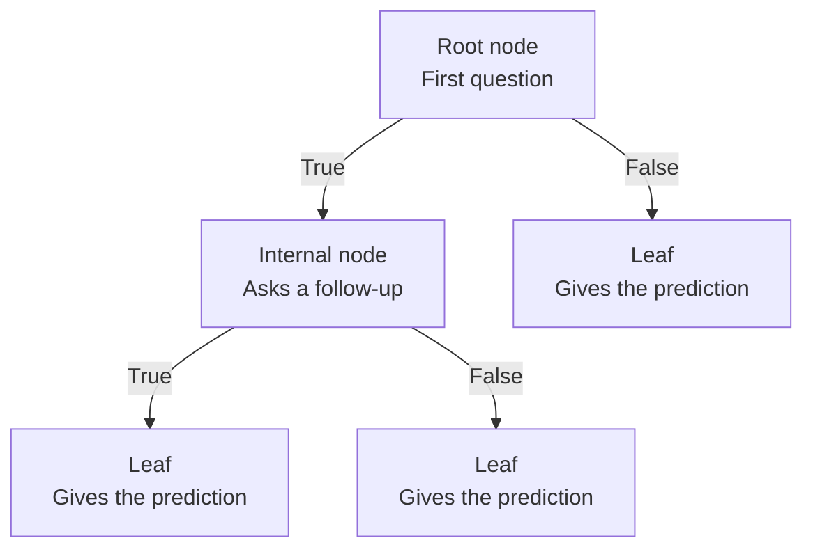
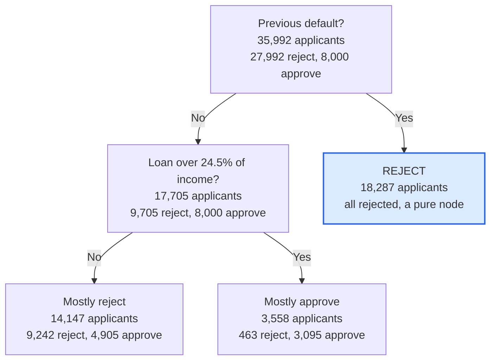
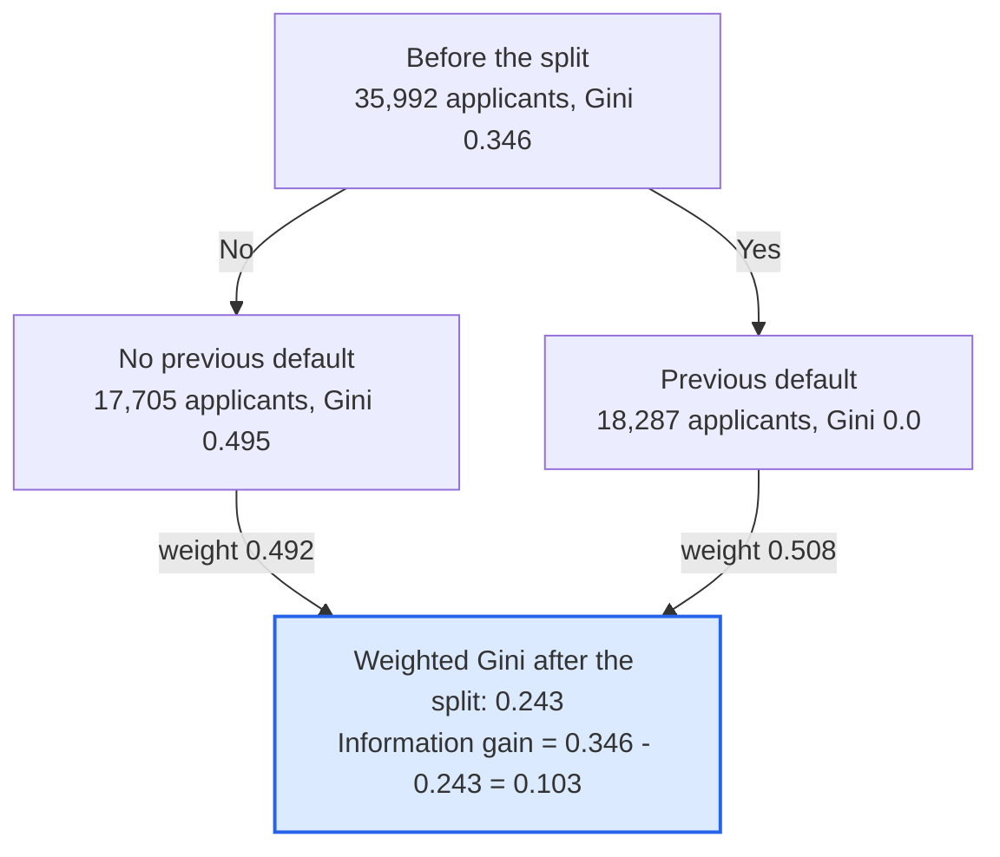
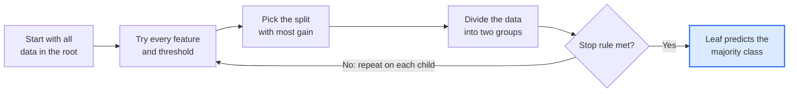

# Decision Tree: A Complete Guide

*Part of the ML Repo (Supervised Learning). Includes the Loan Approval project as a running example.*

## Table of Contents
1. [What is a Decision Tree?](#1-what-is-a-decision-tree)
2. [Anatomy of a Decision Tree](#2-anatomy-of-a-decision-tree)
3. [A Simple Example: Loan Decision as Rules](#3-a-simple-example-loan-decision-as-rules)
4. [How Does a Tree Learn?](#4-how-does-a-tree-learn)
5. [Hyperparameters](#5-hyperparameters-controlling-the-tree)
6. [Overfitting and Underfitting](#6-overfitting-and-underfitting)
7. [Evaluating a Decision Tree](#7-evaluating-a-decision-tree)
8. [Class Imbalance](#8-class-imbalance)
9. [Advantages and Disadvantages](#9-advantages-and-disadvantages)
10. [Decision Tree vs Logistic Regression](#10-decision-tree-vs-logistic-regression)
11. [Decision Tree in scikit-learn](#11-decision-tree-in-scikit-learn)
12. [How to Read a Tree Plot](#12-how-to-read-a-tree-plot)
13. [Findings from the Loan Approval Project](#13-findings-from-the-loan-approval-project)
14. [Common Mistakes to Avoid](#14-common-mistakes-to-avoid)
15. [Glossary](#15-glossary)
16. [What Comes Next](#16-what-comes-next)

---

## 1. What is a Decision Tree?

A **Decision Tree** is a supervised learning algorithm that makes predictions by asking a series of simple *yes / no* questions about the data. Each question splits the data into smaller groups, and the final group gives the answer.

You already use decision trees in daily life. When you decide whether to carry an umbrella, you ask: *Is it cloudy? Is rain forecast? Will I be outside for long?* A Decision Tree does the same thing, but it **learns the questions automatically from data** instead of a human writing them.

A Decision Tree can solve two kinds of problems:

| Type | Output | Example |
|---|---|---|
| **Classification** | A category | Loan approved or rejected, spam or not spam |
| **Regression** | A number | House price, a person's income |

This guide focuses on **classification** (`DecisionTreeClassifier`), because our project predicts loan approval.

## 2. Anatomy of a Decision Tree

A tree is drawn upside down: the first question is at the top and the answers are at the bottom.



Every path from the root down to a leaf is one rule, and depth counts the question levels along that path (root = depth 0, its children = depth 1, and so on).

| Part | Meaning |
|---|---|
| **Root node** | The first and most important question. It contains all the training data. |
| **Internal (decision) node** | A question that splits the data further. |
| **Branch** | One possible answer to a question (for example True or False). |
| **Leaf (terminal) node** | The end of a path. It gives the final prediction and has no more questions. |
| **Depth** | The number of question levels from the root to the deepest leaf. |
| **Parent / child node** | A node and the nodes created directly by splitting it. |

## 3. A Simple Example: Loan Decision as Rules

Imagine a bank wants to decide on loan applications. A trained tree might look like this set of rules:

1. Does the applicant have a **previous loan default**? If yes, **reject**.
2. If no, is the **loan more than 25% of the income**? If no, check the interest rate and income.
3. If yes, does the applicant **rent** their home? Check the income and decide.

This is the top of the tree we trained in this project. Counts are from the depth-5 tree, and the tree continues below the last row.



Every path from the root to a leaf is one readable rule, such as: *no previous default AND loan is a large share of income AND owns a home, therefore approve*. This is why Decision Trees are called **white-box models**: you can see exactly why a decision was made. This matters in banking, medicine and law.

## 4. How Does a Tree Learn?

The tree is built **top-down**. At each node, the algorithm tries many possible questions and picks the one that separates the classes best. This repeats for every new group until a stopping rule is reached.

### 4.1 The goal: pure nodes

A node is **pure** when all its samples belong to one class. For example, a group of 18,287 people who all have a previous default and are all rejected is perfectly pure. The tree keeps asking questions to make groups purer and purer.

### 4.2 Measuring impurity

To choose the best question, the tree needs a number that says how mixed a group is.

**Gini impurity** (the default in scikit-learn):

```
Gini = 1 - (p0^2 + p1^2)
```

Here p0 and p1 are the fractions of samples in class 0 and class 1.

| Group | Gini | Meaning |
|---|---|---|
| 100% one class | 0.0 | Perfectly pure |
| 50% / 50% | 0.5 | Most mixed (worst for two classes) |

**Entropy** is an alternative measure:

```
Entropy = -(p0 * log2(p0) + p1 * log2(p1))
```

It is 0 for a pure node and 1 for a 50/50 node. In practice, Gini and entropy give very similar trees, and Gini is slightly faster.

### 4.3 Information gain

The quality of a split is measured by how much it reduces impurity:

```
Gain = Impurity(parent) - weighted average of Impurity(children)
```

The weights are the share of samples going to each child. The tree picks the split with the **highest gain**.

### 4.4 Worked example from our Loan Approval project

The root node of our tree contained **35,992 applicants**: 27,992 rejected and 8,000 approved.

**Step 1: Gini of the root (before splitting)**
- p0 = 27,992 / 35,992 = 0.778 and p1 = 8,000 / 35,992 = 0.222
- Gini = 1 - (0.778^2 + 0.222^2) = 1 - (0.605 + 0.049) = **0.346**

**Step 2: The question chosen** was *Does the applicant have a previous loan default?*
- **Yes** branch: 18,287 applicants, all rejected. Gini = **0.0** (pure).
- **No** branch: 17,705 applicants (9,705 rejected and 8,000 approved). Gini = 1 - (0.548^2 + 0.452^2) = **0.495**.

**Step 3: Weighted Gini after the split**
- (18,287 / 35,992) x 0.0 + (17,705 / 35,992) x 0.495 = 0 + 0.492 x 0.495 = **0.243**

**Step 4: Information gain** = 0.346 - 0.243 = **0.103**



Each child's Gini is weighted by its share of the 35,992 applicants, then subtracted from the parent's Gini.

The tree tested every feature and every threshold, and this question gave the biggest gain, so it became the **root**. Then the same process repeats separately on the 17,705 applicants in the No branch.

### 4.5 The algorithm in plain steps

1. Start with all training data in the root node.
2. For every feature and every possible threshold, calculate the information gain.
3. Choose the split with the highest gain and divide the data into two child nodes.
4. Repeat steps 2 and 3 on each child node.
5. Stop when a stopping rule is met (pure node, maximum depth, too few samples).
6. The majority class in each leaf becomes the prediction for that leaf.



Stop rules: pure node, maximum depth, too few samples. The same steps repeat on every child node, so the tree grows until each path reaches a leaf.

This method is called **greedy and recursive**. Greedy means it picks the best split *at the current step* without looking ahead. It is fast, but it does not guarantee the best possible tree overall.

### 4.6 How different feature types are split

| Feature type | Example | Question format |
|---|---|---|
| Numeric | `loan_percent_income` | Is it less than or equal to 0.245? (the tree tries many thresholds) |
| Categorical (after one-hot encoding) | `person_home_ownership_RENT` | Is it less than or equal to 0.5? (that means: is the applicant not renting?) |

That is why a column such as `previous_loan_defaults_on_file_Yes <= 0.5` appears in the tree: the one-hot column holds 0 or 1, and the question asks whether it is 0.

## 5. Hyperparameters: Controlling the Tree

If we never stop splitting, the tree keeps going until every leaf is pure. That means it memorizes the training data. Hyperparameters set the limits.

| Hyperparameter | What it controls | Effect of a larger value |
|---|---|---|
| `max_depth` | Maximum number of levels | More complex tree, higher overfitting risk |
| `min_samples_split` | Minimum samples needed to split a node | Simpler tree |
| `min_samples_leaf` | Minimum samples allowed in a leaf | Simpler, smoother tree (very effective) |
| `max_features` | Number of features considered per split | Faster, adds randomness |
| `criterion` | `gini` or `entropy` | Rarely changes results much |
| `class_weight` | Importance of each class | `balanced` helps with imbalanced data |
| `ccp_alpha` | Cost-complexity pruning strength | Removes weak branches, simpler tree |

## 6. Overfitting and Underfitting

| Situation | Training accuracy | Test accuracy | Cause |
|---|---|---|---|
| **Underfitting** | Low | Low | Tree too shallow, cannot capture patterns |
| **Good fit** | High | High (close to training) | Right complexity |
| **Overfitting** | Very high | Much lower | Tree too deep, memorized noise |

A deep tree can create a special rule for almost every training example. Those rules do not apply to new applicants, so test performance drops.

**In our project**, training accuracy rose steadily as `max_depth` grew (reaching about 98% at depth 20), while test accuracy peaked around depth 10 to 11 (about 92%) and then declined. The growing gap between the two lines is overfitting.

**How to reduce overfitting:**
- Limit `max_depth`.
- Increase `min_samples_leaf` or `min_samples_split`.
- Use **pruning** (`ccp_alpha`), which cuts branches that add little value.
- Tune parameters with **cross-validation** (`GridSearchCV`).
- Use ensembles such as **Random Forest**, which average many trees.

## 7. Evaluating a Decision Tree

### 7.1 Confusion matrix

For loan approval, with Approve as the positive class:

| | Predicted Reject | Predicted Approve |
|---|---|---|
| **Actually Reject** | True Negative (TN) | False Positive (FP): a bad loan approved |
| **Actually Approve** | False Negative (FN): a good customer rejected | True Positive (TP) |

### 7.2 Metrics

| Metric | Formula | Question answered |
|---|---|---|
| **Accuracy** | (TP + TN) / total | How often is the model correct overall? |
| **Precision** | TP / (TP + FP) | Of the loans we approved, how many were right? |
| **Recall** | TP / (TP + FN) | Of the loans that should be approved, how many did we find? |
| **F1 score** | 2 x (Precision x Recall) / (Precision + Recall) | Balance between precision and recall |
| **ROC AUC** | Area under the ROC curve | How well does the model rank approvals above rejections? |

### 7.3 Why accuracy alone can mislead

Our data has about 78% rejected and 22% approved loans. A useless model that always says Reject would score about 78% accuracy while approving nobody. That is why we also report precision, recall and F1 for the Approve class.

**Our baseline tree (depth 5):** accuracy 91.1%, Approve precision 0.86, Approve recall 0.72, Approve F1 0.78. Of 2,000 loans that should have been approved, 568 were rejected (the recall problem), and 233 rejected loans were wrongly approved.

### 7.4 The business trade-off

- A **false approval** means the bank may lose money on a bad loan.
- A **false rejection** means the bank loses a good customer and its profit.

Which mistake is worse depends on the bank. This is a business decision, not only a technical one.

## 8. Class Imbalance

When one class is much smaller, the tree favors the majority class because it reduces overall error. Ways to handle it:

- `class_weight="balanced"`: gives the minority class more importance.
- Optimize **F1** or **recall** during tuning instead of accuracy (`scoring="f1"`).
- Adjust the decision **threshold** on predicted probabilities.
- Resample the data (oversample the minority class or undersample the majority class).

Balancing usually raises recall and lowers precision. Always compare both.

## 9. Advantages and Disadvantages

| Advantages | Disadvantages |
|---|---|
| Easy to understand and explain, can be drawn | Overfits easily if the depth is not limited |
| Needs little data preparation (no scaling needed) | Unstable: small data changes can change the whole tree |
| Handles numeric and categorical data | Greedy splitting may miss the best overall tree |
| Captures non-linear relationships and interactions | Sharp, step-like decision boundaries |
| Shows feature importance | Can be biased toward features with many unique values |
| Fast to train and predict | Usually less accurate than ensembles |

## 10. Decision Tree vs Logistic Regression

| Aspect | Decision Tree | Logistic Regression |
|---|---|---|
| Model type | Rule-based, non-linear | Linear (weighted sum of features) |
| Feature scaling | Not needed | Recommended |
| Interpretability | Rules you can read | Coefficients you can read |
| Interactions between features | Found automatically | Must be added manually |
| Overfitting risk | High without limits | Lower |
| Output | Class and probability from leaf | Smooth probability |

Neither is always better. Comparing both on the same dataset, as we do in this project, is good practice.

## 11. Decision Tree in scikit-learn

```python
import pandas as pd
from sklearn.tree import DecisionTreeClassifier, plot_tree
from sklearn.model_selection import train_test_split, GridSearchCV
from sklearn.metrics import classification_report

# 1. Encode text columns and split the data
X = pd.get_dummies(df.drop(columns="loan_status"), drop_first=True)
y = df["loan_status"]
X_train, X_test, y_train, y_test = train_test_split(
    X, y, test_size=0.2, random_state=42, stratify=y)

# 2. Train a baseline tree
tree = DecisionTreeClassifier(max_depth=5, random_state=42)
tree.fit(X_train, y_train)

# 3. Evaluate
print(classification_report(y_test, tree.predict(X_test)))

# 4. Tune with cross-validation
grid = GridSearchCV(
    DecisionTreeClassifier(random_state=42),
    {"max_depth": [6, 8, 10, 12], "min_samples_leaf": [10, 50, 100]},
    cv=5, scoring="f1")
grid.fit(X_train, y_train)
print(grid.best_params_)
```

## 12. How to Read a Tree Plot

Each box produced by `plot_tree` shows:

| Line in the box | Meaning |
|---|---|
| `feature <= value` | The question asked at this node |
| `gini` | Impurity of this node (0 is pure) |
| `samples` | Number of training samples that reached this node |
| `value = [a, b]` | Count of each class: [Reject, Approve] |
| `class` | Majority class, which is the prediction if this were a leaf |

The **left branch** means the condition is True, and the **right branch** means False. Box color shows the majority class (orange for Reject, blue for Approve), and darker color means purer.

## 13. Findings from the Loan Approval Project

1. **Previous loan defaults decide almost everything.** It is the root split, and all 18,287 applicants with a previous default were rejected (a pure node).
2. **Next most useful features:** `loan_percent_income`, `loan_int_rate`, `person_home_ownership` and `person_income`.
3. **Depth matters.** Test accuracy peaked at moderate depth and then declined as the tree overfit.
4. **Imbalance matters.** Accuracy of 91% hides a lower recall of 0.72 for approved loans.
5. **Tuning with cross-validation** picked deeper trees but required a larger `min_samples_leaf` to control overfitting.
6. **Synthetic data warning:** some patterns (such as higher approval for a larger loan-to-income ratio) are unusual for real banks, so the dataset is probably artificially generated.

## 14. Common Mistakes to Avoid

| Mistake | Why it is a problem | Fix |
|---|---|---|
| Keeping ID, name or city columns | The model memorizes unique values | Drop them |
| Data leakage (a feature that reveals the answer) | Unrealistic 99%+ accuracy | Check suspicious columns, compare with and without them |
| Tuning on the test set | Test score becomes over-optimistic | Tune with cross-validation on training data only |
| Reporting only accuracy | Hides poor minority-class results | Report precision, recall and F1 |
| Not limiting depth | Overfitting | Use `max_depth` and `min_samples_leaf` |
| Not stratifying the split | Train and test have different class ratios | Use `stratify=y` |
| Duplicate rows in the data | The same row appears in train and test | Remove duplicates before splitting |

## 15. Glossary

| Term | Simple meaning |
|---|---|
| Feature | An input column (for example `credit_score`) |
| Target / label | The column we predict (`loan_status`) |
| Split | Dividing data into two groups using a question |
| Impurity | How mixed the classes are in a node |
| Gini | A number from 0 (pure) to 0.5 (most mixed, two classes) |
| Information gain | Impurity reduction achieved by a split |
| Pruning | Cutting branches to simplify the tree |
| Cross-validation | Testing on several train/validation splits for a reliable score |
| Hyperparameter | A setting chosen before training (such as `max_depth`) |
| Ensemble | Many models combined into one stronger model |

## 16. What Comes Next

A single tree is easy to understand but unstable and prone to overfitting. The next model in this repo is **Random Forest**: it trains hundreds of trees on random parts of the data and features, then lets them vote. This keeps most of the strengths of a Decision Tree and fixes much of its instability. After that comes **Gradient Boosting / XGBoost**, which builds trees one after another, each correcting the mistakes of the previous one.
