# Credit Card Fraud Detection: Complete Documentation

Yeh document is project ke har hissay ko explain karta hai: data kya hai, kaun kaun si techniques aur algorithms use hui, kyun use hui, aur final result kya aaya. Saare diagrams (jo algorithms ki working samjhane ke liye khud banaye gaye hain) `pics/` folder mein hain.

---

## Fehrist (Table of Contents)

1. [Project ka maqsad](#1-project-ka-maqsad)
2. [Project structure](#2-project-structure)
3. [Dataset ki tafseel](#3-dataset-ki-tafseel)
4. [Libraries jo use hui](#4-libraries-jo-use-hui)
5. [Pipeline ka overview](#5-pipeline-ka-overview)
6. [Step by step explanation](#6-step-by-step-explanation)
7. [Algorithms ki tafseel](#7-algorithms-ki-tafseel)
8. [Evaluation metrics](#8-evaluation-metrics)
9. [Results aur comparison](#9-results-aur-comparison)
10. [Threshold selection aur cost analysis](#10-threshold-selection-aur-cost-analysis)
11. [Final model ki performance](#11-final-model-ki-performance)
12. [Model save aur dobara load karna](#12-model-save-aur-dobara-load-karna)
13. [Limitations](#13-limitations)
14. [Conclusion](#14-conclusion)
15. [Glossary](#15-glossary)

---

## 1. Project ka maqsad

Credit card transactions mein se **fraud (dhoka) wali transactions** pehchanna. Yeh ek **supervised learning** (binary classification) problem hai, kyunke dataset ki har transaction par label laga hua hai:

- `Class = 0` : normal transaction
- `Class = 1` : fraud transaction

Sab se bari mushkil yeh hai ke dataset **bohat imbalanced** hai: 283,726 transactions mein sirf 473 fraud hain (**0.17%**). Is wajah se normal accuracy bekaar metric hai, aur project mein precision, recall, F1, ROC-AUC aur PR-AUC use kiye gaye hain.

---

## 2. Project structure

```
project/
├── Credit_Card_Fraud_Detection.ipynb   # main notebook
├── Data/
│   └── creditcard.csv                  # dataset
├── outputs/
│   ├── models/
│   │   ├── xgboost_fraud_model.pkl     # final XGBoost model
│   │   ├── random_forest_smote.pkl     # reference ke liye Random Forest
│   │   ├── scaler.pkl                  # fitted RobustScaler
│   │   └── config.json                 # threshold aur feature columns ki list
│   ├── graphs/                         # notebook ke generated graphs
│   ├── model_comparison.csv            # 6 models ka comparison
│   └── threshold_analysis.csv          # threshold vs cost table
└── docs/
    ├── README.md                       # yeh file
    └── pics/                           # algorithms ki working ke diagrams (01 se 13)
```

---

## 3. Dataset ki tafseel

| Cheez | Detail |
|---|---|
| Source | European cardholders ki credit card transactions |
| Total rows (original) | 284,807 |
| Duplicate rows | 1,081 (remove kiye gaye) |
| Rows after cleaning | 283,726 |
| Columns | 31 (30 features + 1 target) |
| Missing values | Koi nahi |
| Normal transactions | 283,253 (99.83%) |
| Fraud transactions | 473 (0.17%) |

**Columns:**

- `Time` : pehli transaction se guzray seconds (raw feature).
- `V1` se `V28` : **PCA** se bane anonymized features. Privacy ki wajah se asli naam nahi diye gaye.
- `Amount` : transaction ki raqam (raw feature, bohat skewed).
- `Class` : target (0 ya 1).

---

## 4. Libraries jo use hui

| Library | Kis kaam ke liye |
|---|---|
| `pandas`, `numpy` | Data load karna, cleaning, calculations |
| `matplotlib` | Graphs banana aur save karna |
| `scikit-learn` | Train/test split, RobustScaler, Random Forest, metrics |
| `imbalanced-learn (imblearn)` | SMOTE, RandomUnderSampler, imblearn Pipeline |
| `xgboost` | XGBClassifier (final model) |
| `joblib` | Model aur scaler ko `.pkl` file mein save/load karna |
| `json`, `os` | Config file likhna, folders banana |

---

## 5. Pipeline ka overview

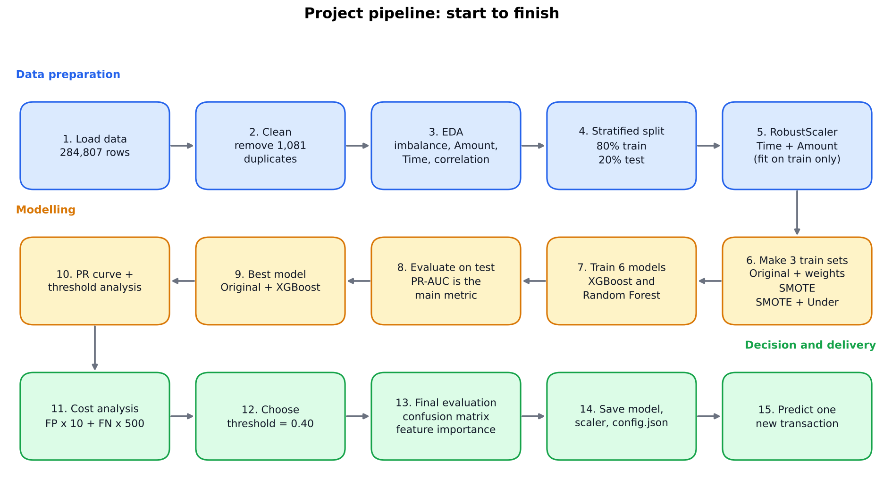

```
Data load
   ↓
Data quality check (missing values, duplicates remove)
   ↓
EDA (class imbalance, Amount, Time, correlation)
   ↓
Stratified train/test split (80/20)
   ↓
RobustScaler (sirf Time aur Amount, sirf train par fit)
   ↓
Teen training datasets:
   1. Original (+ class weights)
   2. SMOTE
   3. SMOTE + Random Undersampling
   ↓
2 algorithms x 3 datasets = 6 models train
   ↓
Test set par evaluation (PR-AUC main metric)
   ↓
Best model: Original + XGBoost
   ↓
Precision-Recall curve + Threshold analysis + Cost analysis
   ↓
Threshold = 0.40 chuna gaya
   ↓
Final evaluation, confusion matrix, feature importance
   ↓
Model + scaler + config save, dobara load karke verify
```

---

## 6. Step by step explanation

### 6.1 Setup aur helper functions

Do helper functions banaye gaye:

- `save_plot(filename)` : har graph ko `outputs/graphs/` mein 150 dpi par save karta hai.
- `save_artifacts(...)` : model, scaler, aur `config.json` ko `outputs/models/` mein save karta hai.

Folders `os.makedirs(..., exist_ok=True)` se khud ban jate hain.

### 6.2 Data quality checks

1. `isnull().sum()` se missing values check hui. Koi missing value nahi mili.
2. `duplicated().sum()` se **1,081 duplicate rows** mili.
3. `drop_duplicates()` se hata di gayin.

**Duplicates kyun hataye?** Agar ek hi transaction train aur test dono mein aa jaye to model test set ko "yaad" kar leta hai aur result jhoota achha lagta hai. Isay **data leakage** kehte hain.

### 6.3 Class imbalance


Normal: 283,253, Fraud: 473. Agar model har transaction ko "normal" bol de to bhi accuracy **99.83%** aati hai, par wo ek bhi fraud nahi pakadta. Isi liye accuracy use nahi hui.

### 6.4 Exploratory Data Analysis (EDA)

#### Amount distribution


- Dono classes mein zyada transactions chhoti raqam ki hain.
- Normal transactions 25,000 tak jati hain, jabke sab se bara fraud lagbhag 2,100 ka hai.
- Fraud ka median (9.82) normal ke median (22.00) se kam hai.
- `Amount` right-skewed hai aur outliers hain, is liye aage **RobustScaler** use hua.
- Graph mein y-axis **log scale** par hai taake chhote aur bare bars dono nazar aayein.

#### Time distribution


- Normal transactions din raat ka cycle follow karti hain.
- Fraud zyada uneven hai (10k, 40k, 90k seconds ke aas paas spikes), aur normal activity kam hone par bhi hota hai.
- Sirf 473 fraud cases hain, is liye kuch spikes shayad noise hon. `Time` akela strong feature nahi hai.

#### Correlation with target


- `V17`, `V14`, `V12`, `V10` fraud se sab se zyada **negatively** correlated hain (V17 lagbhag -0.31).
- `V11` aur `V4` sab se zyada **positively** correlated hain.
- `Time` aur `Amount` ka linear correlation lagbhag zero hai.
- Correlation sirf **linear** relation pakadta hai. Tree-based models non-linear patterns bhi seekhte hain, is liye sirf correlation ki base par koi feature drop nahi kiya gaya.

### 6.5 Train/Test split aur scaling

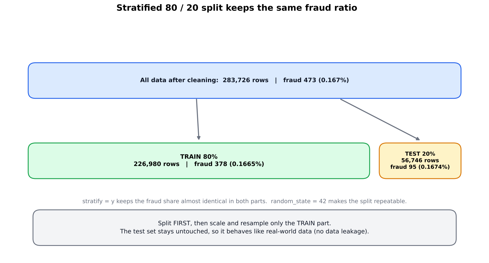

```python
X_train, X_test, y_train, y_test = train_test_split(
    X, y, test_size=0.2, stratify=y, random_state=42
)
```

- **80% train** (226,980 rows), **20% test** (56,746 rows).
- **`stratify=y`**: dono sets mein fraud ka ratio barabar rehta hai (train 0.1665%, test 0.1674%).
- Test set mein lagbhag **95 fraud cases** hain, is liye metrics mein thori si tabdeeli (1-2 cases se) bhi farq daal sakti hai.

**Scaling:**

- Sirf `Time` aur `Amount` scale hue, kyunke `V1` se `V28` pehle hi PCA ke output hain.
- `RobustScaler` use hua, jo median aur IQR istemal karta hai, is liye outliers se kam mutasir hota hai.
- Scaler sirf **train set par fit** hua (`fit_transform`), aur test par sirf `transform` hua. Warna test ki information train mein leak ho jati.
- **Split scaling aur sampling se pehle** kiya gaya, yeh bhi leakage se bachne ke liye zaroori hai.

### 6.6 Class imbalance handle karna

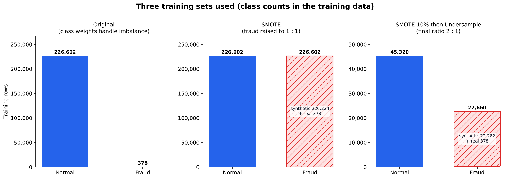

Sampling **sirf training set par** hui. Test set ko kabhi resample nahi kiya, taake wo real duniya jaisa rahe.

| Approach | Train set ke baad |
|---|---|
| Original + class weights | Normal 226,602, Fraud 378 (weights ke saath) |
| SMOTE | Normal 226,602, Fraud 226,602 |
| SMOTE + Undersampling | Normal 45,320, Fraud 22,660 (2:1 ratio) |

Class weights sirf original data par lagaye gaye. SMOTE wale datasets pehle hi balanced hain, wahan weights lagane se imbalance **do baar** correct ho jata.

Note: SMOTE ne 378 asli fraud cases se lagbhag 226,000 bana diye, yani zyadatar fraud samples **synthetic** hain. Is liye results hamesha untouched test set par judge hue, train scores par nahi.

### 6.7 Model training

Teen datasets par do algorithms (XGBoost aur Random Forest) train hue, yani kul **6 models**. Sab ko ek hi test set par default threshold 0.5 par evaluate kiya gaya.

**XGBoost ke parameters:**

| Parameter | Value | Matlab |
|---|---|---|
| `n_estimators` | 200 | 200 trees |
| `max_depth` | 5 | har tree ki max gehrai |
| `learning_rate` | 0.1 | har tree ka contribution |
| `scale_pos_weight` | ratio (Original par) ya 1 | fraud errors ki sazaa barhana |
| `eval_metric` | `aucpr` | PR-AUC par evaluate |
| `random_state` | 42 | repeatable results |
| `n_jobs` | -1 | saare CPU cores |

`ratio = normal count / fraud count` (train mein lagbhag 599).

**Random Forest ke parameters:**

| Parameter | Value |
|---|---|
| `n_estimators` | 100 |
| `class_weight` | `"balanced"` (Original par), warna `None` |
| `random_state` | 42 |
| `n_jobs` | -1 |

### 6.8 Threshold selection

Model ek **probability** deta hai (0 se 1). Threshold wo hadd hai jis se upar transaction ko fraud kaha jata hai. Default 0.5 hota hai, par har problem mein best nahi hota. Iska detail [section 10](#10-threshold-selection-aur-cost-analysis) mein hai.

### 6.9 Final evaluation aur feature importance

Section 11 mein detail hai.

---

## 7. Algorithms ki tafseel

### 7.1 XGBoost (Extreme Gradient Boosting)

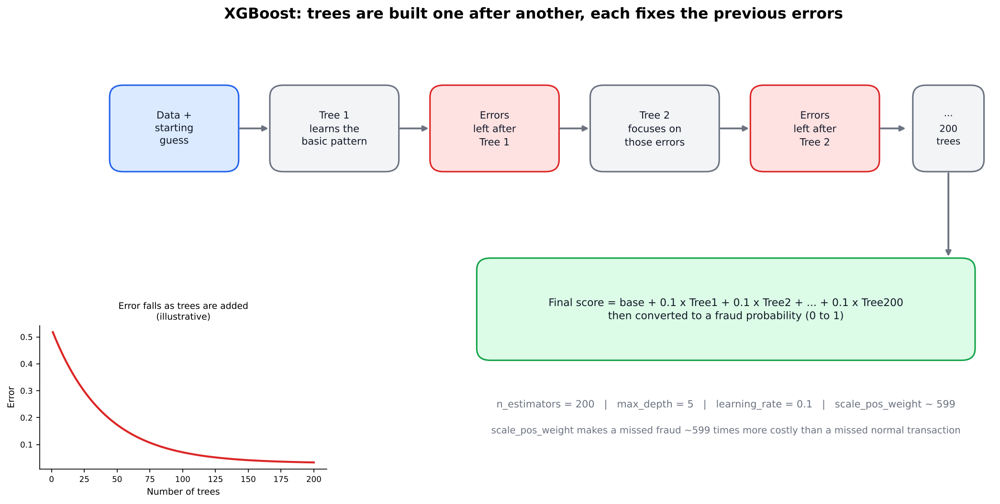

**Type:** Gradient Boosted Decision Trees (ensemble).

**Kaise kaam karta hai:**

1. Pehla chhota decision tree banta hai jo thori bohat predictions karta hai.
2. Phir har naya tree pichlay trees ki **galtiyan (errors)** sudharne ke liye banta hai. Yeh sequentially hota hai (boosting).
3. Har tree ka contribution `learning_rate` se control hota hai.
4. Aakhir mein saare trees ki predictions jama hoti hain.
5. Loss function ka **gradient** use hota hai taake agla tree sahi direction mein seekhe.
6. Built-in **regularization** overfitting rokti hai.

**Is project mein kyun use hua:**

- Tabular data par bohat achha perform karta hai.
- `scale_pos_weight` se imbalance seedha handle ho jata hai.
- Non-linear patterns pakad leta hai.
- **Result:** best PR-AUC (0.8204) Original data par.

### 7.2 Random Forest

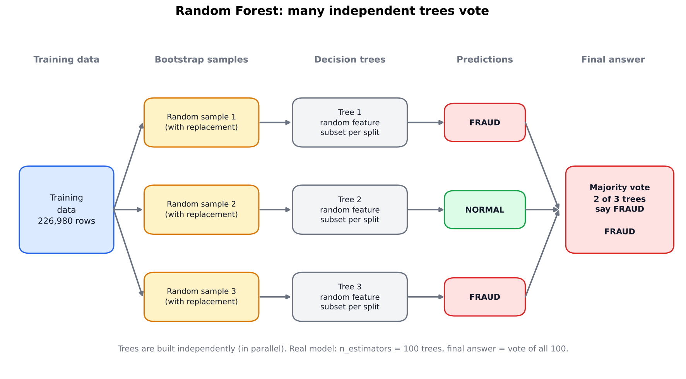

**Type:** Bagging ensemble of decision trees.

**Kaise kaam karta hai:**

1. Training data ke alag alag random samples (**bootstrap**) liye jate hain.
2. Har sample par ek decision tree banta hai, aur har split par features ka random subset dekha jata hai.
3. Saare trees **parallel** (ek dosray se azad) bante hain.
4. Final prediction saare trees ka **voting/average** hota hai.

**Boosting se farq:** Random Forest mein trees azad hote hain aur variance kam karte hain. XGBoost mein trees ek dosray ki ghalti theek karte hain.

**Imbalance ke liye:** `class_weight="balanced"` fraud class ko zyada weight deta hai.

### 7.3 SMOTE (Synthetic Minority Over-sampling Technique)

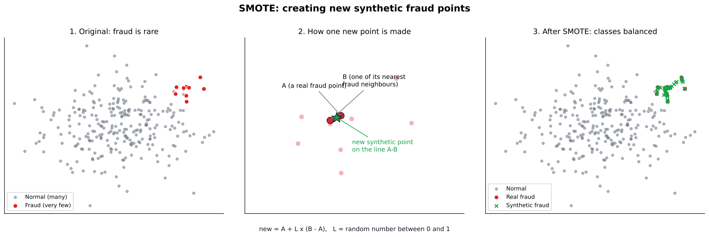

**Maqsad:** Minority class (fraud) ke naye **synthetic** samples bana kar classes ko barabar karna.

**Kaise kaam karta hai:**

1. Ek fraud sample chuna jata hai.
2. Uske `k` qareebi fraud neighbors (default k=5) dhoondhe jate hain.
3. Ek neighbor random chuna jata hai.
4. In dono ke beech ki line par ek random point par naya sample banta hai:

   `naya = sample + random(0,1) × (neighbor − sample)`

**Faida:** Sirf purane samples copy karne (random oversampling) se behtar, kyunke naye points banate hain.

**Nuqsan:** Synthetic data asli nahi hota. Is project mein SMOTE ne precision bohat gira di (XGBoost ke liye 0.88 se 0.55).

### 7.4 SMOTE + Random Undersampling (combined)

`imblearn.pipeline.Pipeline` mein do steps:

1. `SMOTE(sampling_strategy=0.1)` : fraud ko normal ka 10% tak barhata hai.
2. `RandomUnderSampler(sampling_strategy=0.5)` : normal samples random hata kar fraud ko normal ka 50% (2:1 ratio) tak le aata hai.

**Idea:** Na zyada synthetic data, na zyada asli data zaya. Final train set chhota (67,980 rows) aur kam imbalanced.

### 7.5 RandomUnderSampler

Majority class (normal) se random samples hata deta hai taake classes ka ratio behtar ho jaye. Tez hai, par asli data ki information zaya hoti hai.

### 7.6 RobustScaler

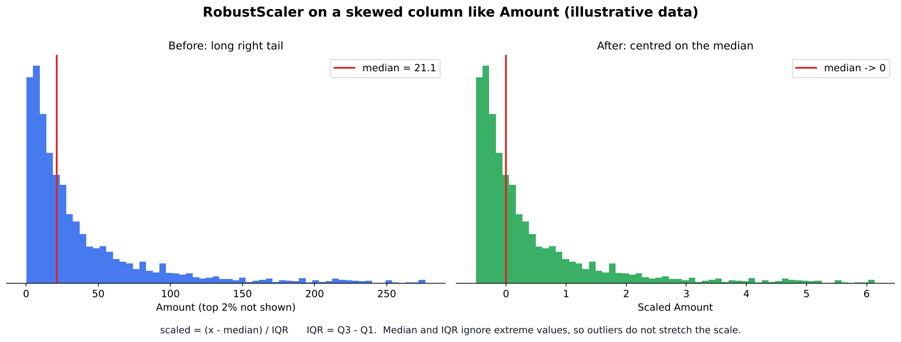

Formula:

`scaled = (x − median) / IQR`

jahan IQR = Q3 − Q1. Median aur IQR outliers se zyada mutasir nahi hote, is liye `Amount` jaise skewed feature ke liye StandardScaler se behtar hai.

### 7.7 Decision Tree (building block)

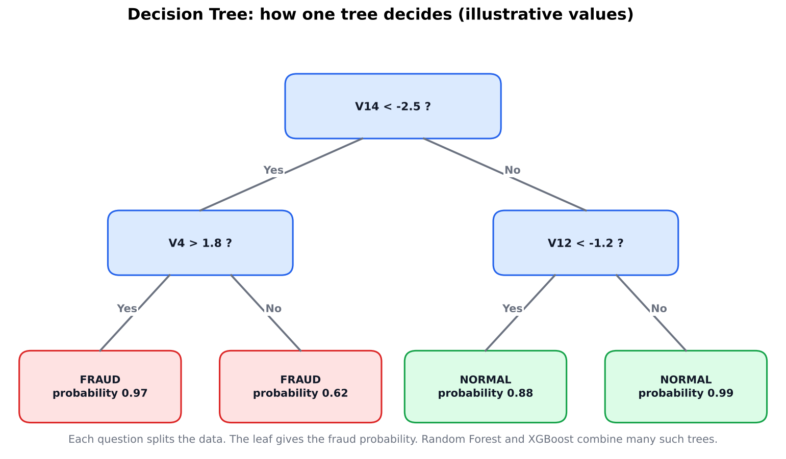

XGBoost aur Random Forest dono decision trees se bante hain. Tree data ko sawalon (jaise "V14 < -2.5?") ke zariye branches mein baant kar aakhir mein ek class ya value predict karta hai. Splits ki quality Gini impurity (Random Forest) ya gradient/loss based gain (XGBoost) se naapi jati hai.

### 7.8 PCA (data mein pehle se lagi hui)

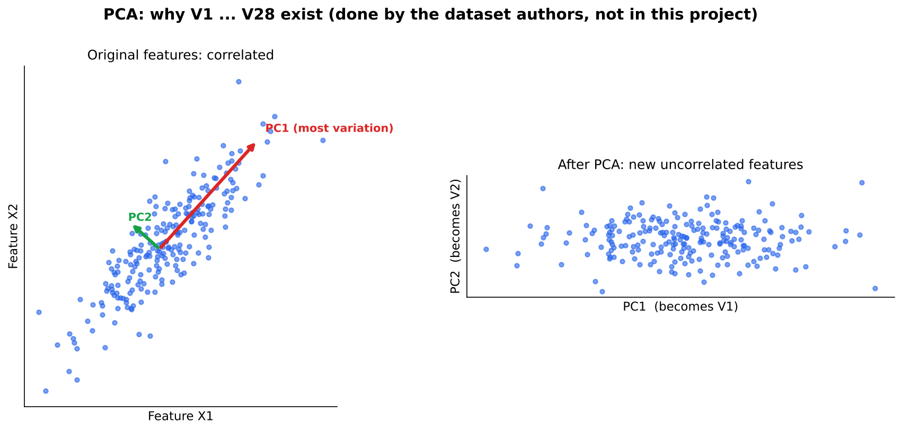

`V1` se `V28` dataset ke asli features nahi, balkay **Principal Component Analysis** ke components hain. PCA correlated features ko naye uncorrelated features mein badalta hai. Yeh dataset banane walon ne privacy ke liye kiya tha, is project mein dobara PCA nahi chalaya gaya.

### 7.9 Stratified Train/Test Split

Data ko is tarah baantna ke dono hisson mein class ka ratio wohi rahe jo original mein tha. Imbalanced data mein yeh zaroori hai, warna test set mein fraud shayad hota hi na.

### 7.10 Pearson Correlation

`data_frame.corr()` har feature aur target ke beech ka linear relationship (-1 se +1) naapta hai. EDA mein features samajhne ke liye use hua.

---

## 8. Evaluation metrics

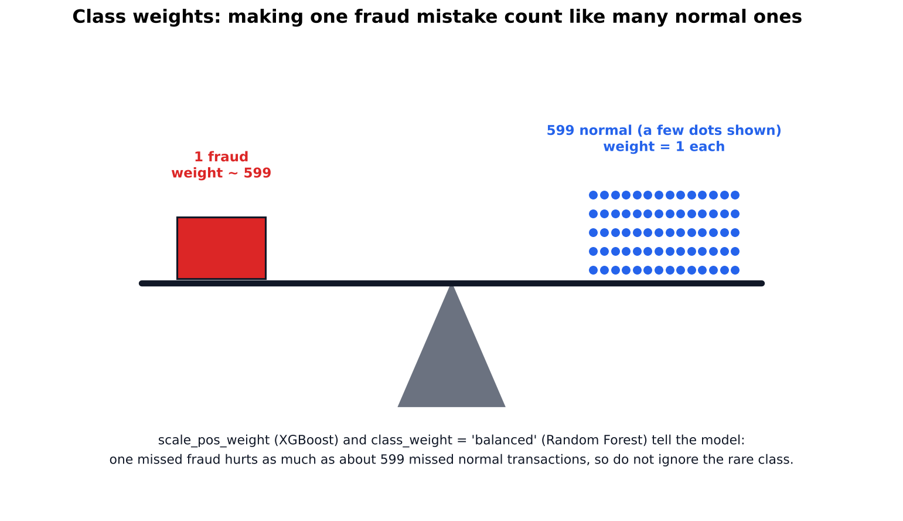

Confusion matrix ke 4 hissay:

| | Predicted Normal | Predicted Fraud |
|---|---|---|
| **Actual Normal** | TN (sahi) | FP (jhoota alarm) |
| **Actual Fraud** | FN (fraud miss) | TP (fraud pakda) |

| Metric | Formula | Matlab |
|---|---|---|
| **Precision** | TP / (TP + FP) | Jitne ko fraud kaha, un mein se kitne sach mein fraud the |
| **Recall** | TP / (TP + FN) | Asli fraud mein se kitne pakde gaye |
| **F1** | 2 × (P × R) / (P + R) | Precision aur recall ka balance |
| **ROC-AUC** | ROC curve ke neeche ka area | Classes ko alag karne ki salahiyat (imbalanced data par optimistic) |
| **PR-AUC** | Precision-Recall curve ke neeche ka area | Imbalanced data ke liye zyada bharosay ka metric |

**Is project mein PR-AUC ko main guide rakha gaya**, kyunke ROC-AUC imbalanced data par sab models ke liye bohat achha dikhata hai.

---

## 9. Results aur comparison

Default threshold 0.5 par, test set par:

| Sampling | Model | Precision | Recall | F1 | ROC-AUC | PR-AUC |
|---|---|---|---|---|---|---|
| **Original** | **XGBoost** | 0.8824 | 0.7895 | 0.8333 | 0.9692 | **0.8204** |
| SMOTE | XGBoost | 0.5532 | 0.8211 | 0.6610 | 0.9653 | 0.8142 |
| SMOTE | RandomForest | 0.9136 | 0.7789 | 0.8409 | 0.9590 | 0.8073 |
| SMOTE+Under | XGBoost | 0.5390 | 0.8000 | 0.6441 | 0.9700 | 0.8063 |
| SMOTE+Under | RandomForest | 0.7857 | 0.8105 | 0.7979 | 0.9710 | 0.8020 |
| Original | RandomForest | 0.9710 | 0.7053 | 0.8171 | 0.9246 | 0.7960 |

**Nataij:**

- PR-AUC values qareeb hain (0.796 se 0.820). Test set mein sirf ~95 fraud hain, is liye yeh farq kuch had tak noise ho sakta hai, koi saaf winner nahi.
- SMOTE se XGBoost ka recall thora barha (0.79 se 0.82), par precision bohat gir gayi (0.88 se 0.55), yani bohat zyada jhoote alarm.
- **Original + XGBoost** ka PR-AUC sab se acha aur precision/recall ka balance bhi achha hai, wo bhi bina kisi resampling ke. Isi liye final model yehi chuna gaya.
- Random Forest (Original) ki precision sab se zyada (0.97) hai par recall sab se kam (0.71), yani sab se zyada fraud miss karta hai.

---

## 10. Threshold selection aur cost analysis

### Precision-Recall curve

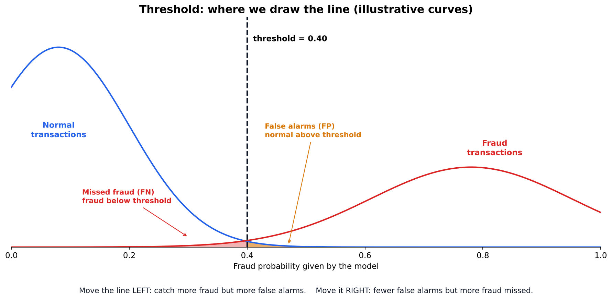


- Jab tak recall lagbhag 0.80 tak hai, precision 0.9 se 1.0 ke darmiyan rehti hai.
- 0.80 recall ke baad precision tezi se gir jati hai, yani 80% se zyada fraud pakadne ki koshish mein bohat zyada jhoote alarm aate hain.

### Precision aur Recall vs Threshold


- Threshold 0.1 se 0.6 ke beech recall lagbhag 0.80 rehta hai jabke precision lagbhag 0.65 se 0.90 tak barhti hai. Is range mein threshold barhane se precision mehfooz tareeqay se behtar hoti hai.
- 0.1 se neeche precision bohat tezi se girti hai, recall mein bohat mamooli izafay ke badle.
- 0.9 se upar recall girna shuru ho jata hai.
- Curves seedhi (step jaisi) isliye hain ke test set mein sirf ~95 fraud hain, is liye threshold ko ek exact value ki bajaye **range** ki tarah report karna chahiye.

### Business cost model

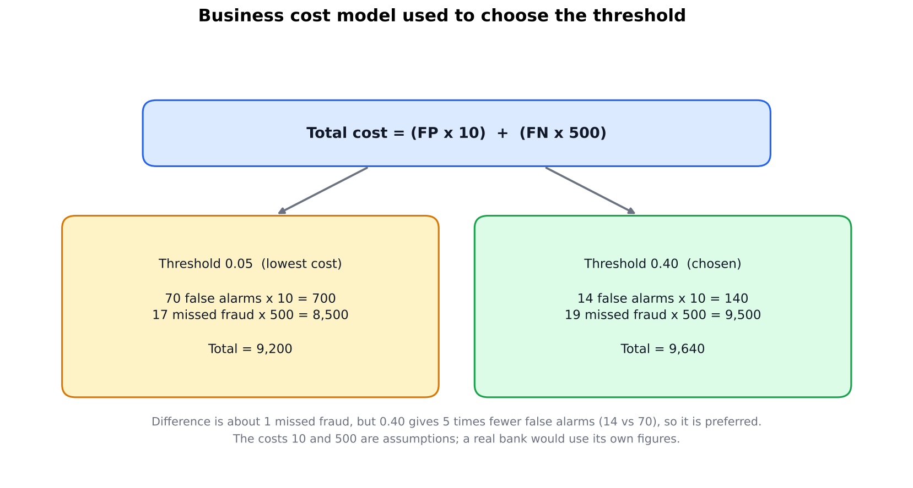

```
Total Cost = (FP × COST_FP) + (FN × COST_FN)
```

Assumptions (illustration ke liye, asli bank ke asli numbers se badalni chahiye):

- `COST_FN = 500` : ek fraud miss hone ka nuqsan
- `COST_FP = 10` : ek jhoote alarm ka kharcha (review, customer support)

Mukhtalif thresholds ke results:

| Threshold | Precision | Recall | FP | FN | Total Cost |
|---|---|---|---|---|---|
| 0.05 | 0.5270 | 0.8211 | 70 | 17 | **9,200** |
| 0.10 | 0.6581 | 0.8105 | 40 | 18 | 9,400 |
| 0.30 | 0.8172 | 0.8000 | 17 | 19 | 9,670 |
| **0.40** | **0.8444** | **0.8000** | **14** | **19** | **9,640** |
| 0.50 | 0.8824 | 0.7895 | 10 | 20 | 10,100 |
| 0.60 | 0.9024 | 0.7789 | 8 | 21 | 10,580 |
| 0.80 | 0.9351 | 0.7579 | 5 | 23 | 11,550 |
| 0.90 | 0.9730 | 0.7579 | 2 | 23 | 11,520 |
| 0.95 | 0.9722 | 0.7368 | 2 | 25 | 12,520 |

(Poori table `outputs/threshold_analysis.csv` mein hai.)

### Strategy ka intikhab

| Strategy | Threshold | Precision | Recall | FP | FN | Kab use karein |
|---|---|---|---|---|---|---|
| Maximum fraud catch | 0.05 | 0.53 | 0.82 | 70 | 17 | Fraud ka nuqsan bohat bara ho aur review team bari ho |
| **Balanced (chuna gaya)** | **0.40** | **0.84** | **0.80** | **14** | **19** | Qareeb qareeb kam se kam cost, 5 guna kam jhoote alarm |
| Kam customer pareshani | 0.85 se 0.90 | 0.96 se 0.97 | 0.76 | 2 se 3 | 23 | Customer experience sab se ahem ho |

**Faisla:** Threshold **0.40** (munasib range 0.3 se 0.5). Cost ka farq 0.05 aur 0.40 ke darmiyan sirf ek fraud miss ke barabar hai (9,200 vs 9,640), jo is chhote test set mein noise ke andar hai. 0.40 se 0.05 par jaane mein sirf 2 aur fraud pakday jate hain magar 56 extra jhoote alarm aate hain.

**Caveat:** Threshold test set par chuna gaya, is liye numbers thore optimistic hain. Production mein threshold ek alag **validation set** par chunna chahiye aur test set sirf aakhri check ke liye rakhna chahiye.

---

## 11. Final model ki performance

**Model:** XGBoost (Original data + `scale_pos_weight`), **Threshold = 0.40**

| Metric | Value |
|---|---|
| Precision | 0.8444 |
| Recall | 0.8000 |
| F1 | 0.8216 |
| ROC-AUC | 0.9692 |
| PR-AUC | 0.8204 |

### Confusion matrix

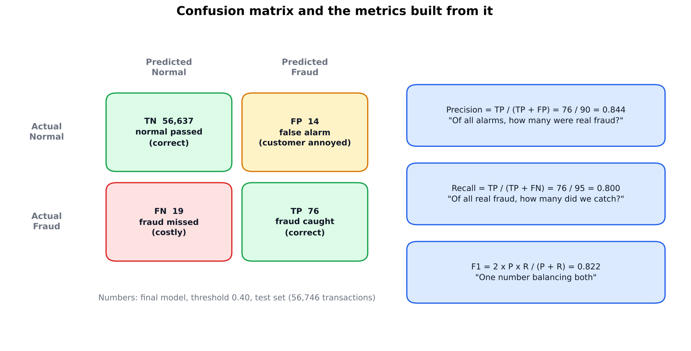


Test set (56,746 transactions, ~95 fraud) par threshold 0.40 par:

- **True Positive (TP):** 76 fraud sahi pakde gaye
- **False Negative (FN):** 19 fraud miss hue (sab se mehnga error)
- **False Positive (FP):** 14 normal transactions ghalat fraud kahi gayin (customer pareshani)
- **True Negative (TN):** 56,637 normal transactions sahi guzar gayin

### Feature importance


XGBoost ke mutabiq top 10 features:

| Rank | Feature | Importance |
|---|---|---|
| 1 | V14 | 0.5247 |
| 2 | V4 | 0.0605 |
| 3 | V8 | 0.0380 |
| 4 | V12 | 0.0340 |
| 5 | V10 | 0.0289 |
| 6 | V3 | 0.0274 |
| 7 | V13 | 0.0219 |
| 8 | V19 | 0.0213 |
| 9 | V17 | 0.0179 |
| 10 | V11 | 0.0167 |

`V14` bohat dominant hai (lagbhag 52%). Correlation plot ke sath compare karne par nazar aata hai ke model ne un features (V14, V12, V10, V17, V4, V11) ko bhi use kiya jo correlation mein nazar aaye the, aur sath mein `V8`, `V3` jaise features bhi, jo linear correlation se itne numaya nahi thay.

---

## 12. Model save aur dobara load karna

Save hone wali files (`outputs/models/`):

| File | Kya hai |
|---|---|
| `xgboost_fraud_model.pkl` | Final XGBoost model |
| `scaler.pkl` | Train par fit hua RobustScaler |
| `config.json` | `threshold` (0.40) aur `feature_columns` ki sahi tarteeb |
| `random_forest_smote.pkl` | Reference ke liye Random Forest (SMOTE) |

### Ek transaction ki prediction

`predict_fraud(transaction)` function:

1. Ek transaction (raw values) leta hai.
2. `Time` aur `Amount` ko saved scaler se scale karta hai.
3. Model se fraud ki probability nikalta hai.
4. Agar probability >= threshold ho to `"FRAUD"`, warna `"NOT FRAUD"` return karta hai.

Demo mein ek asli fraud (probability 0.9975, FRAUD) aur ek normal transaction (probability 0.0, NOT FRAUD) sahi predict hui.

### Verification

Notebook mein saved files ko `joblib.load` aur `config.json` se dobara load karke wohi predictions chalayi gayin. Nataij bilkul wohi aaye, yani saved model akela (training objects ke baghair) kaam karta hai.

```python
import joblib, json

model  = joblib.load("outputs/models/xgboost_fraud_model.pkl")
scaler = joblib.load("outputs/models/scaler.pkl")
config = json.load(open("outputs/models/config.json"))
```

**Note:** `V1` se `V28` anonymized PCA features hain, is liye asli user inhe khud type nahi kar sakta. Demo mein dataset ki rows istemal hui hain.

---

## 13. Limitations

- Test set mein sirf ~95 fraud cases hain, is liye models aur thresholds ke chhote farq par pura bharosa nahi kiya ja sakta.
- Cost values (500 aur 10) farzi (assumptions) hain.
- Threshold test set par chuna gaya. Production mein alag validation set chahiye.
- Data sirf do din ki transactions ka hai, aur fraud ke patterns waqt ke sath badalte hain. Model ko regular retraining aur monitoring chahiye.
- SMOTE ke synthetic samples asli fraud patterns ko pura represent nahi karte.

---

## 14. Conclusion

- **Masla:** Fraud sirf 0.17% hai, is liye accuracy bekaar hai aur precision, recall, PR-AUC par kaam hua.
- **Kya kaam kiya:** Original data par XGBoost (`scale_pos_weight` ke sath) ne sab se achha PR-AUC (0.820) diya. SMOTE aur SMOTE + undersampling is dataset par behtari nahi laye, balkay precision gira di.
- **Precision vs recall:** Threshold kam karne se zyada fraud pakadte hain par jhoote alarm bhi barhte hain. 0.05 par recall 82% aur precision 53%, jabke 0.40 par recall 80% aur precision 84% hai.
- **Business faisla:** Threshold lagbhag **0.40** (range 0.3 se 0.5) recommend kiya gaya. Asli threshold bank ke fraud nuqsan aur jhoote alarm ke asli kharchay par depend karta hai.

---

## 15. Glossary

| Lafz | Matlab |
|---|---|
| Supervised learning | Aisi learning jahan data par pehle se labels hote hain |
| Imbalanced data | Aisa data jahan ek class bohat kam ho |
| Data leakage | Test ki information ka training mein pohanch jana |
| Overfitting | Model ka training data ko ratt lena aur naye data par fail hona |
| Ensemble | Kai models ko mila kar ek model banana |
| Boosting | Models ko ek ke baad ek bana kar pichli ghaltiyan sudharna |
| Bagging | Models ko azad tor par alag samples par bana kar average lena |
| Threshold | Wo probability hadd jis ke upar transaction fraud kehlati hai |
| PCA | Features ko naye uncorrelated components mein badalne ka tareeqa |
| Stratified | Class ratio ko har hissay mein barabar rakhna |
| Hyperparameter | Wo setting jo training se pehle hum khud chunte hain (jaise `max_depth`) |
| Synthetic sample | Asli nahi balkay algorithm ka banaya hua naya sample |
