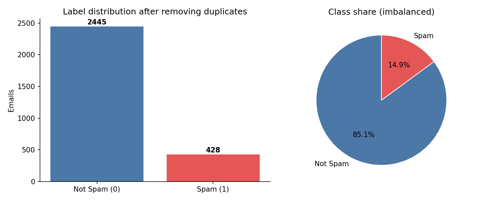
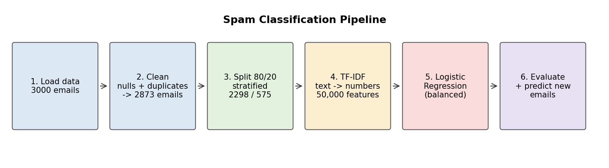
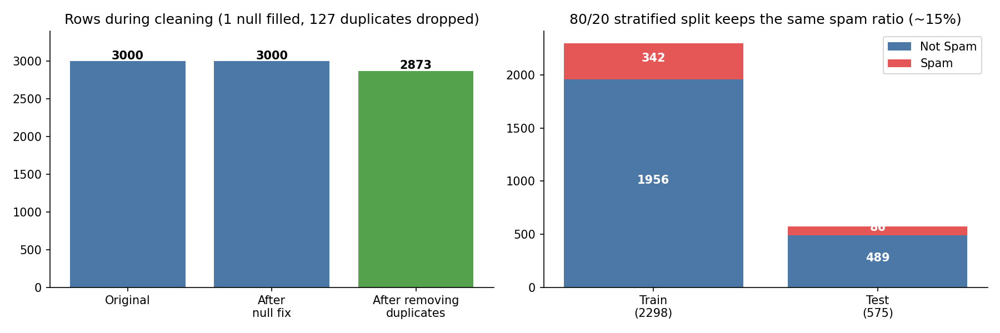
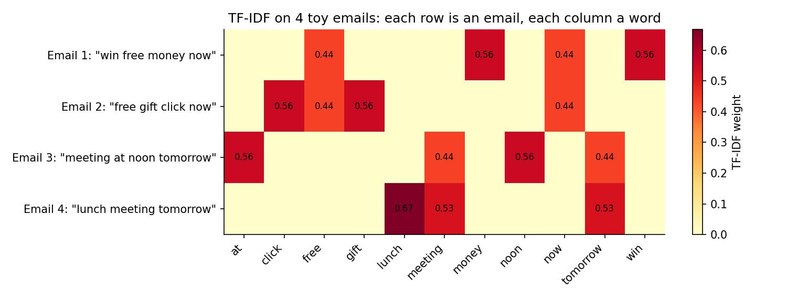
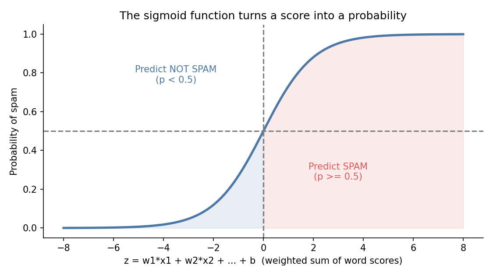
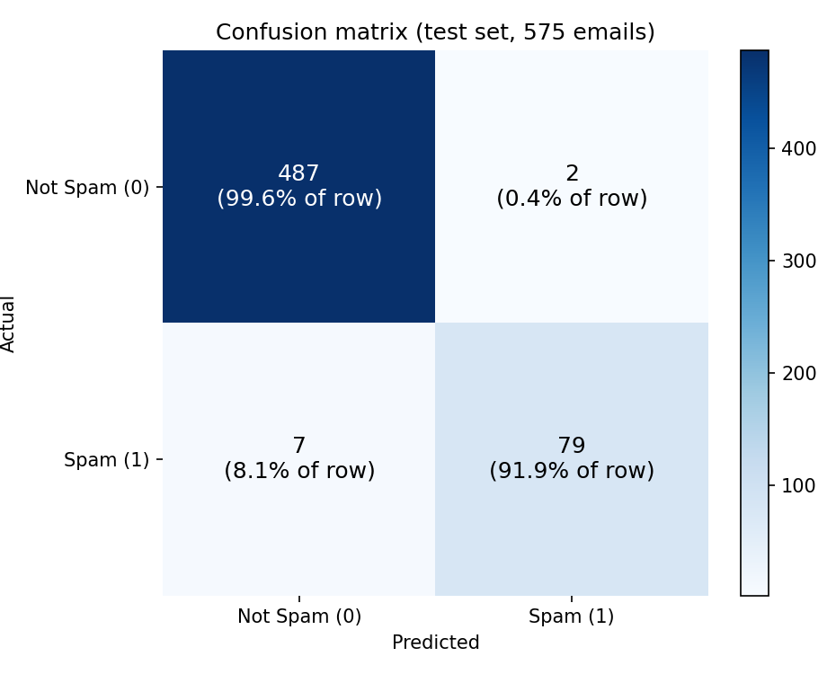
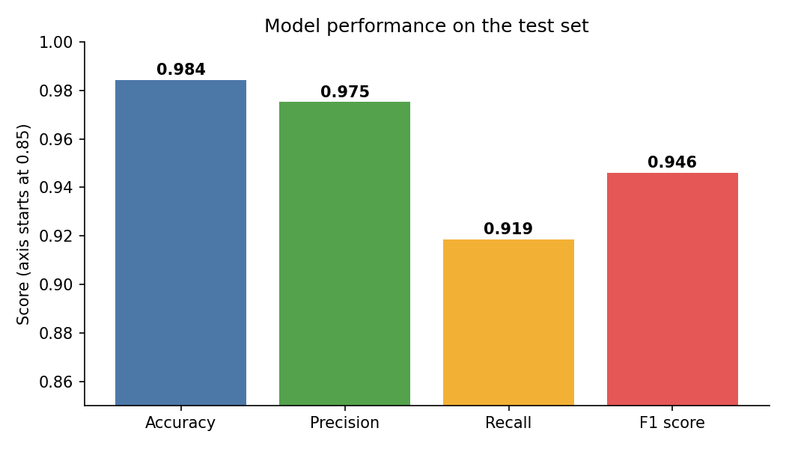
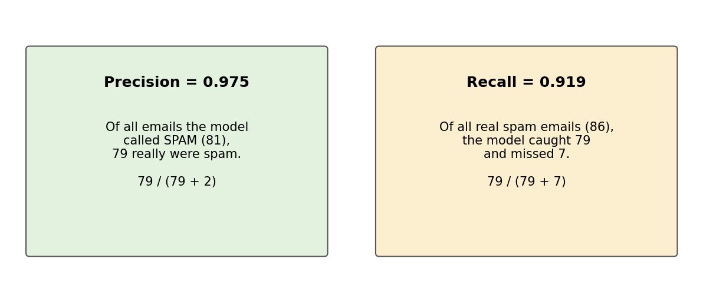

# Spam Classification using TF-IDF and Logistic Regression

A machine learning project that reads the text of an email and decides whether it is **spam** or **not spam**. The text is converted into numbers with **TF-IDF**, and a **Logistic Regression** model learns to separate the two classes.

**Final result on the test set:** Accuracy 98.4%, Precision 97.5%, Recall 91.9%, F1 score 94.6%.

---

## Table of Contents

1. [Problem Statement](#1-problem-statement)
2. [Dataset](#2-dataset)
3. [Project Pipeline](#3-project-pipeline)
4. [Data Cleaning](#4-data-cleaning)
5. [Train/Test Split](#5-traintest-split)
6. [TF-IDF: Turning Text into Numbers](#6-tf-idf-turning-text-into-numbers)
7. [Logistic Regression: How the Classifier Works](#7-logistic-regression-how-the-classifier-works)
8. [Model Evaluation](#8-model-evaluation)
9. [Predicting a New Email](#9-predicting-a-new-email)
10. [Strengths and Limitations](#10-strengths-and-limitations)
11. [Suggested Improvements](#11-suggested-improvements)
12. [How to Run](#12-how-to-run)

---

## 1. Problem Statement

Given the text of an email, predict whether it is spam.

- **Type of problem:** supervised learning, binary classification
- **Input (X):** email text
- **Output (Y):** `0` = Not Spam, `1` = Spam

A computer cannot work with raw words, so the main challenge is to convert text into numeric features. After that, any classifier can be applied. This project uses TF-IDF for the conversion and Logistic Regression for the classification.

---

## 2. Dataset

File: `spam_or_not_spam.csv`

| Column | Description |
|---|---|
| `email` | The text of the email |
| `label` | `1` if the email is spam, `0` if it is not |

- **Size:** 3000 rows and 2 columns
- **Data quality issues found:** 1 missing email text, 127 duplicate rows

After cleaning, 2873 emails remain. The classes are **imbalanced**:

| Class | Count | Share |
|---|---|---|
| Not Spam (0) | 2445 | 85.1% |
| Spam (1) | 428 | 14.9% |



*Only about 1 in 7 emails is spam. A model that always answers "Not Spam" would already be 85% accurate, so accuracy alone is not enough to judge this project. That is why precision, recall and F1 are also used.*

---

## 3. Project Pipeline



1. Load the data
2. Handle missing values and duplicates
3. Split into training and test sets (stratified)
4. Convert text to numbers with TF-IDF
5. Train a Logistic Regression model
6. Evaluate with accuracy, precision, recall, F1 and the confusion matrix, then predict new emails

---

## 4. Data Cleaning

| Step | What was done | Why |
|---|---|---|
| Shape and info check | Looked at rows, columns and data types | To understand the data |
| Missing values | 1 missing email was filled with the most frequent email text (`mode`) | The vectorizer cannot process a missing value |
| Duplicates | 127 duplicate rows were removed | Duplicates can appear in both train and test sets and make the score look better than it really is |
| Label distribution | Counted spam vs not spam | To detect class imbalance |



*Left: row counts during cleaning (3000 to 2873). Right: the train/test split keeps the same spam ratio in both parts.*

**Why remove duplicates before splitting?** If the same email is present in both the training and test data, the model is effectively tested on something it has already seen. Removing duplicates first gives a more honest evaluation.

---

## 5. Train/Test Split

```python
X_train, X_test, Y_train, Y_test = train_test_split(
    X, Y, test_size=0.2, random_state=42, stratify=Y
)
```

| Part | Emails | Not Spam | Spam |
|---|---|---|---|
| Train | 2298 | 1956 | 342 |
| Test | 575 | 489 | 86 |

- **`test_size=0.2`:** 80% for learning, 20% for testing.
- **`random_state=42`:** makes the split reproducible.
- **`stratify=Y`:** keeps the spam share (about 15%) the same in both parts. Without it, the small test set could end up with too few spam emails by chance.

---

## 6. TF-IDF: Turning Text into Numbers

**TF-IDF** (Term Frequency, Inverse Document Frequency) gives every word in an email a weight.

- **TF (term frequency):** how often a word appears in this email. A word that appears many times matters more for this email.
- **IDF (inverse document frequency):** how rare the word is across all emails. Common words ("the", "email") get a low weight. Rare and distinctive words ("lottery", "unsubscribe") get a high weight.

$$\text{TF-IDF}(t, d) = \text{TF}(t, d) \times \text{IDF}(t)$$

$$\text{IDF}(t) = \ln\left(\frac{1 + N}{1 + df(t)}\right) + 1$$

where $N$ is the number of emails and $df(t)$ is the number of emails that contain the word $t$. This is the formula scikit-learn uses. The final vector of each email is also normalized, so long and short emails are comparable.

**Toy example with 4 emails**



*Each row is an email and each column is a word. Words such as "free" and "now" appear in the spam-like emails, while "meeting" and "tomorrow" appear in the normal ones. A classifier can learn from these patterns.*

**Settings used in this project**

```python
TF_IDF = TfidfVectorizer(
    lowercase=True,
    stop_words="english",
    ngram_range=(1, 2),
    max_features=50000
)
```

| Parameter | Meaning |
|---|---|
| `lowercase=True` | "FREE" and "free" are treated as the same word |
| `stop_words="english"` | Removes very common words such as "the", "is" and "and" |
| `ngram_range=(1, 2)` | Uses single words and pairs of words (for example "click here"). Pairs capture short phrases that are typical for spam |
| `max_features=50000` | Keeps only the 50,000 most important terms, to limit memory and noise |

**Fit only on the training data**

```python
X_train_TF_IDF = TF_IDF.fit_transform(X_train)   # learn vocabulary + IDF, then transform
X_test_TF_IDF  = TF_IDF.transform(X_test)        # only transform
```

The vocabulary and IDF values must be learned from the training data only. If the test data were included, information from the test set would leak into the model and the evaluation would not be honest.

**Result:** the training matrix has shape `(2298, 50000)` and the test matrix has shape `(575, 50000)`. These matrices are mostly zeros (sparse), because each email contains only a small part of the whole vocabulary.

---

## 7. Logistic Regression: How the Classifier Works

Despite the name, **Logistic Regression is a classification algorithm.** It works in two steps.

**Step 1: weighted sum.** Every word (feature) has a learned weight $w$. The model adds up the TF-IDF value of each word multiplied by its weight, plus a bias $b$:

$$z = w_1 x_1 + w_2 x_2 + \dots + w_n x_n + b$$

Words typical for spam get positive weights, and words typical for normal emails get negative weights.

**Step 2: sigmoid.** The score $z$ can be any number, so the sigmoid function converts it into a probability between 0 and 1:

$$P(\text{spam}) = \sigma(z) = \frac{1}{1 + e^{-z}}$$



*A large positive score gives a probability close to 1 (spam). A large negative score gives a probability close to 0 (not spam). The default decision threshold is 0.5.*

**How it learns.** Training finds the weights that minimize the **log loss** (cross-entropy). The loss is small when the model gives a high probability to the correct class and large when it is confidently wrong:

$$\text{Loss} = -\frac{1}{m}\sum_{i=1}^{m}\left[y_i \ln(p_i) + (1 - y_i)\ln(1 - p_i)\right]$$

scikit-learn uses an optimization algorithm (by default `lbfgs`) that updates the weights step by step until the loss stops improving.

**Settings used in this project**

```python
model = LogisticRegression(max_iter=1000, class_weight="balanced", random_state=42)
```

| Parameter | Meaning |
|---|---|
| `max_iter=1000` | Maximum number of optimizer iterations. The default of 100 can be too small for 50,000 features |
| `class_weight="balanced"` | Gives spam (the rare class) a higher weight in the loss, so mistakes on spam cost more. This helps with the 85/15 imbalance |
| `random_state=42` | Reproducible results |

Logistic Regression also uses **L2 regularization** by default (`C=1.0`). It keeps the weights small and reduces overfitting, which is important with 50,000 features and only 2298 training emails.

---

## 8. Model Evaluation

### 8.1 Confusion Matrix



| | Predicted Not Spam | Predicted Spam |
|---|---|---|
| **Actual Not Spam** | 487 (true negatives) | 2 (false positives) |
| **Actual Spam** | 7 (false negatives) | 79 (true positives) |

- **True positives (79):** spam correctly caught.
- **True negatives (487):** normal emails correctly kept.
- **False positives (2):** normal emails wrongly marked as spam. This is the most harmful mistake in practice, because a user may miss an important email.
- **False negatives (7):** spam that reached the inbox.

### 8.2 Metrics



| Metric | Formula | Value | Meaning |
|---|---|---|---|
| **Accuracy** | (TP + TN) / total | **0.984** | 566 of 575 emails classified correctly |
| **Precision** | TP / (TP + FP) | **0.975** | When the model says "spam", it is right 97.5% of the time |
| **Recall** | TP / (TP + FN) | **0.919** | The model finds 91.9% of all real spam |
| **F1 score** | 2PR / (P + R) | **0.946** | Balance between precision and recall |



### 8.3 Classification Report

| Class | Precision | Recall | F1 | Support |
|---|---|---|---|---|
| Not Spam | 0.99 | 1.00 | 0.99 | 489 |
| Spam | 0.98 | 0.92 | 0.95 | 86 |
| **Accuracy** | | | **0.98** | 575 |
| Macro avg | 0.98 | 0.96 | 0.97 | 575 |
| Weighted avg | 0.98 | 0.98 | 0.98 | 575 |

### 8.4 Interpretation

- The model is very reliable when it flags an email as spam (only 2 false alarms).
- Its main weakness is **recall on spam**: 7 of 86 spam emails were missed.
- Macro average is a bit lower than the weighted average because the spam class is smaller and slightly weaker. This is why looking at accuracy alone would hide the real picture.

---

## 9. Predicting a New Email

```python
new_email_TF_IDF = TF_IDF.transform(new_email)
prediction = model.predict(new_email_TF_IDF)
prob = model.predict_proba(new_email_TF_IDF)
```

The new email must go through the **same fitted vectorizer** (`transform`, not `fit_transform`) so it uses the same vocabulary and weights as training.

For the sample email in the notebook (a promotional message with "free gift", "discount", "click here" and similar phrases), the model predicted **SPAM** with a probability of about **0.94**.

`predict_proba` returns two numbers per email: the probability of class 0 and of class 1. `predict` simply picks the class with the higher probability (threshold 0.5).

---

## 10. Strengths and Limitations

**Strengths**

- Simple, fast and easy to explain.
- Strong baseline for text classification.
- Gives probabilities, not just labels.
- Weights can be inspected to see which words indicate spam.
- Handles high-dimensional sparse data well.

**Limitations**

- TF-IDF ignores word order and meaning (context and sarcasm are not understood).
- Works only for words and phrases seen during training. Spammers can change wording to avoid detection.
- Imbalanced data means accuracy can be misleading.
- Small dataset (2873 emails), so results may change on other data.
- A single train/test split gives only one estimate of performance.

---

## 11. Suggested Improvements

1. **Cross-validation** (for example 5-fold stratified) to get a more stable performance estimate.
2. **Threshold tuning:** change the 0.5 cut-off. A lower threshold raises recall, a higher one raises precision.
3. **ROC curve and Precision-Recall curve** for a fuller picture than a single threshold.
4. **Hyperparameter tuning** with `GridSearchCV` (for example `C`, `ngram_range`, `max_features`).
5. **Use a `Pipeline`** that combines TF-IDF and Logistic Regression. It prevents leakage and makes saving and deploying easier.
6. **Inspect the most important words** from the model weights:

```python
import numpy as np
words = np.array(TF_IDF.get_feature_names_out())
order = np.argsort(model.coef_[0])
print("Most NOT-spam words:", words[order[:15]])
print("Most SPAM words    :", words[order[-15:]])
```

7. **Compare with other models:** Naive Bayes, Linear SVM and Random Forest.
8. **Try modern text features** such as word embeddings or transformer models if more accuracy is needed.

---

## 12. How to Run

```bash
pip install pandas numpy scikit-learn matplotlib jupyter
jupyter notebook spam_classification.ipynb
```

Place `spam_or_not_spam.csv` in the same folder as the notebook, then use **Run All**.

---

*Figures in this README are drawn from the actual numbers in the notebook outputs (class counts, confusion matrix and metrics). The TF-IDF example uses 4 made-up emails only to illustrate the idea.*
