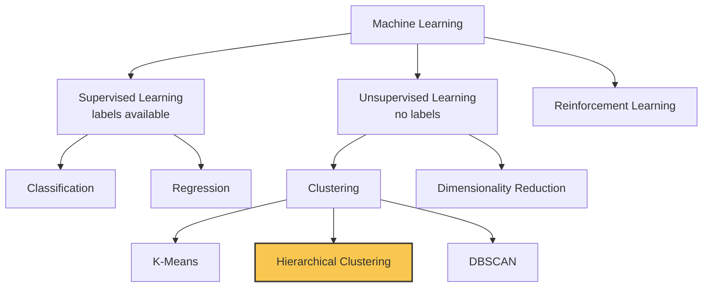
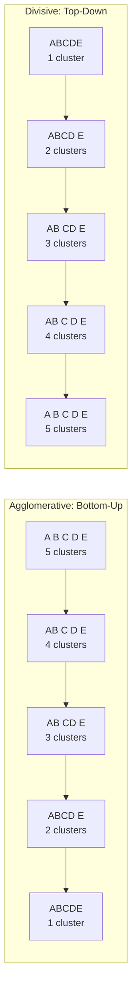
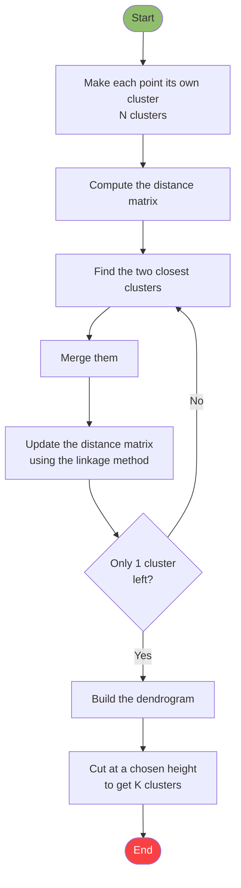
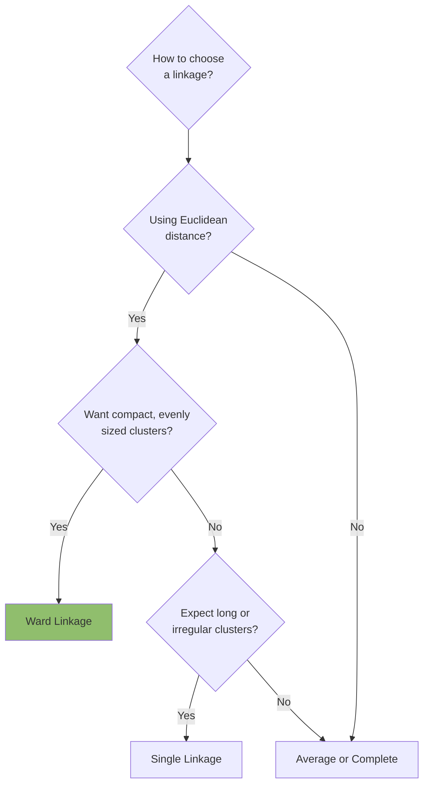
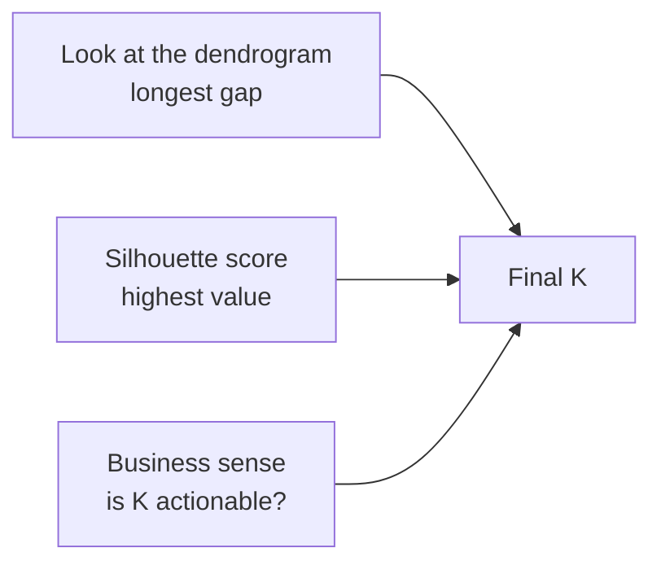
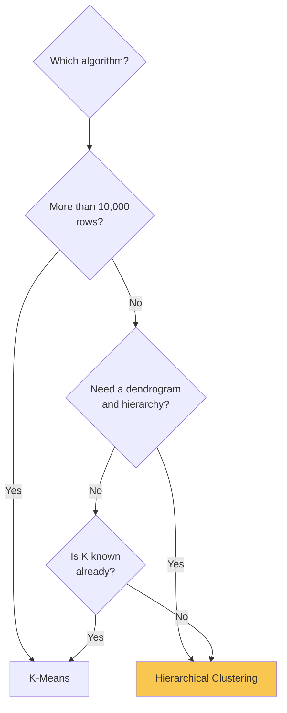
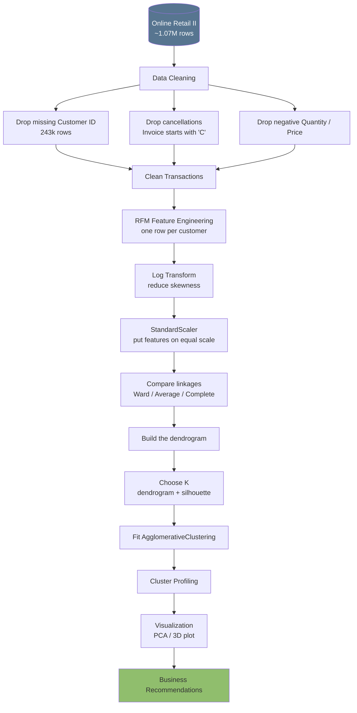
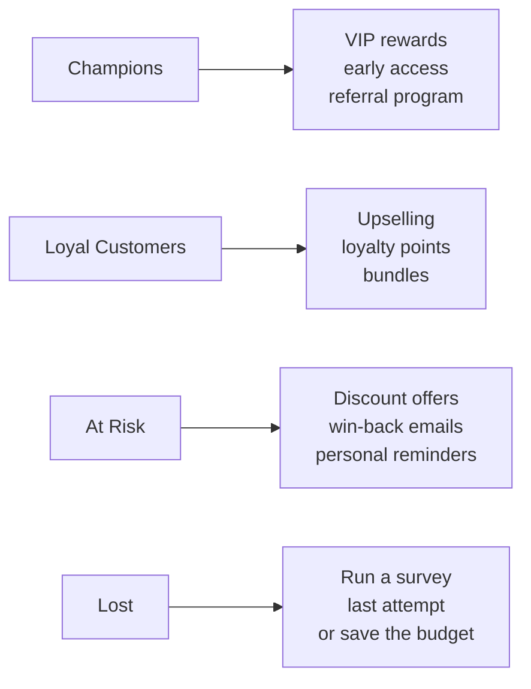

# Hierarchical Clustering: Complete Documentation

**Project:** Customer Segmentation on the Online Retail II Dataset
**Algorithm:** Agglomerative Hierarchical Clustering

---

## Table of Contents

1. [What is Hierarchical Clustering?](#1-what-is-hierarchical-clustering)
2. [Where it fits in Machine Learning](#2-where-it-fits-in-machine-learning)
3. [Two Types: Agglomerative and Divisive](#3-two-types-agglomerative-and-divisive)
4. [The Algorithm Step by Step](#4-the-algorithm-step-by-step)
5. [Worked Example (by hand)](#5-worked-example-by-hand)
6. [Distance Metrics](#6-distance-metrics)
7. [Linkage Methods](#7-linkage-methods)
8. [Reading a Dendrogram](#8-reading-a-dendrogram)
9. [Choosing the Number of Clusters](#9-choosing-the-number-of-clusters)
10. [Evaluation Metrics](#10-evaluation-metrics)
11. [Complexity and Limitations](#11-complexity-and-limitations)
12. [Comparison with K-Means](#12-comparison-with-k-means)
13. [Project Pipeline](#13-project-pipeline)
14. [Python Implementation](#14-python-implementation)
15. [Cluster Profiling and Business Interpretation](#15-cluster-profiling-and-business-interpretation)
16. [Common Mistakes](#16-common-mistakes)
17. [Glossary](#17-glossary)

---

## 1. What is Hierarchical Clustering?

Hierarchical Clustering is an **unsupervised machine learning** algorithm that groups data points into clusters based on their **similarity**. Instead of producing one flat set of groups, it builds a **tree of clusters** called a **dendrogram**.

**Everyday analogy:** A family tree. Siblings form the smallest group, cousins join them to form a larger one, and eventually the whole extended family is one group. Hierarchical clustering does the same with data.

**Key properties:**

- No target column (labels) required
- The number of clusters does not need to be chosen in advance (unlike K-Means)
- Deterministic: the same data always gives the same result
- The dendrogram shows the full structure of the data at every level of detail

---

## 2. Where it fits in Machine Learning



---

## 3. Two Types: Agglomerative and Divisive

| | **Agglomerative** | **Divisive** |
|---|---|---|
| Approach | Bottom-up | Top-down |
| Start | Every point is its own cluster | All data in one cluster |
| Process | Repeatedly merges the closest clusters | Repeatedly splits the largest cluster |
| End | One cluster containing everything | Every point is its own cluster |
| Usage | **Very common (used in this project)** | Rare, computationally expensive |



```
Agglomerative (bottom to top):       Divisive (top to bottom):

  A  B  C  D  E                         [ A B C D E ]
  \_/  \_/   |                               |
   AB   CD   E                         [ A B C D ]  [ E ]
    \___/    |                              |
     ABCD    |                         [AB] [CD]  [E]
       \____/                              |
       ABCDE                           A B C D E
```

> The rest of this document focuses on **Agglomerative** clustering.

---

## 4. The Algorithm Step by Step

1. **Treat every data point as its own cluster.** With N points, you start with N clusters.
2. **Compute the distance matrix.** Calculate the distance between every pair of points.
3. **Find the two closest clusters.**
4. **Merge them** into one new cluster.
5. **Update the distance matrix.** Compute the distance from the new cluster to all others using the chosen linkage method.
6. **Repeat steps 3 to 5** until only one cluster remains.
7. **Build the dendrogram** and cut it at a suitable height to obtain K clusters.



---

## 5. Worked Example (by hand)

Take 1-dimensional data with 5 points: **A=1, B=2, C=6, D=7, E=15**

### Step 0: Distance matrix

|   | A | B | C | D | E |
|---|---|---|---|---|---|
| **A** | 0 | 1 | 5 | 6 | 14 |
| **B** | 1 | 0 | 4 | 5 | 13 |
| **C** | 5 | 4 | 0 | 1 | 9 |
| **D** | 6 | 5 | 1 | 0 | 8 |
| **E** | 14 | 13 | 9 | 8 | 0 |

### Merging with Single Linkage

| Step | Closest pair | Distance | Resulting clusters |
|---|---|---|---|
| 1 | A and B | 1 | {AB}, C, D, E |
| 2 | C and D | 1 | {AB}, {CD}, E |
| 3 | {AB} and {CD} | min(5, 4, 6, 5) = **4** | {ABCD}, E |
| 4 | {ABCD} and E | min(14, 13, 9, 8) = **8** | {ABCDE} |

With single linkage, the distance between two clusters is the distance between their **closest members**. That is why step 3 gives 4 (from B to C).

### Resulting dendrogram

```
Distance
   8 |                    ┌───────────────┐
     |                    │               │
   7 |                    │               │
     |                    │               │
   4 |          ┌─────────┴────┐          │
     |          │              │          │
   1 |      ┌───┴───┐      ┌───┴───┐      │
     |      │       │      │       │      │
   0 |      A       B      C       D      E
```

### On the number line

```
 A B           C D                           E
 ●─●           ●─●                           ●
 1 2           6 7                          15
 └┬┘           └┬┘
 {AB}          {CD}          <- formed first
 └──────┬───────┘
      {ABCD}                 <- then this (distance 4)
        └──────────────────────┬──────────┘
                           {ABCDE}   <- last (distance 8)
```

To get **K = 2**, cut the dendrogram between heights 4 and 8. This gives **{A, B, C, D}** and **{E}**, with E isolated as an outlier.

---

## 6. Distance Metrics

Distance measures how far apart two points are.

| Metric | Formula | When to use |
|---|---|---|
| **Euclidean** | √Σ(xᵢ − yᵢ)² | Most common, straight-line distance. Required for Ward linkage |
| **Manhattan** | Σ\|xᵢ − yᵢ\| | Slightly more robust to outliers, grid-like data |
| **Cosine** | 1 − cos(θ) | Text or high-dimensional data |
| **Gower** | Mixed formula | Datasets with both numeric and categorical columns |

```
Euclidean vs Manhattan (between two points):

   y
   |            B ●
   |           /|
   |   Euclid / |  Manhattan
   |         /  |  (horizontal + vertical)
   |        /   |
   |   A ●──────┘
   |________________ x

   Euclidean = straight diagonal line from A to B
   Manhattan = walk along x first, then along y
```

> **In this project:** Euclidean distance with Ward linkage.

---

## 7. Linkage Methods

The linkage method defines **how the distance between two clusters is measured**. It has the biggest influence on the shape of the resulting clusters.

### 7.1 Single Linkage (Minimum)

Distance between the **closest** pair of points, one from each cluster.

```
   Cluster 1          Cluster 2
   ● ● ●                 ● ●
  ● ● ● ●●────────────●● ●
   ● ●                  ● ●
              ^
        shortest distance
```

- Pros: Can detect long, irregular clusters
- Cons: **Chaining effect**, where clusters stretch into long chains. Sensitive to outliers

### 7.2 Complete Linkage (Maximum)

Distance between the **farthest** pair of points.

```
   Cluster 1          Cluster 2
   ● ● ●                 ● ●
  ● ● ● ●              ● ●
 ●─────────────────────────●
   ^
   longest distance
```

- Pros: Compact, similarly sized clusters
- Cons: Can be affected by outliers

### 7.3 Average Linkage (UPGMA)

**Average** distance across all pairs of points between the two clusters.

```
   Cluster 1          Cluster 2
   ● ─ ─ ─ ─ ─ ─ ─ ─ ●
   ● ─ ─ ─ ─ ─ ─ ─ ─ ●     average of all lines
   ● ─ ─ ─ ─ ─ ─ ─ ─ ●
```

- Pros: A balanced compromise between single and complete
- Cons: Slightly more computation

### 7.4 Ward Linkage (the most popular)

Merges the pair of clusters that causes the **smallest increase in within-cluster variance (SSE)**.

```
   Before merge:          After merge:
   [●●●]   [●●●]          [●●●●●●]
   small    small         how much did variance grow?
   variance variance      the pair with the smallest growth merges
```

- Pros: Compact, **evenly sized** clusters, similar to K-Means. Excellent for customer segmentation
- Cons: Works only with Euclidean distance

### Comparison

| Linkage | Cluster shape | Outlier sensitivity | Size balance | Recommendation |
|---|---|---|---|---|
| Single | Long, chain-like | Very high | Uneven | Rarely used |
| Complete | Round, compact | High | Fairly even | Acceptable |
| Average | Intermediate | Low | Moderate | Good |
| **Ward** | **Round, compact** | **Low** | **Even** | **Best default** |



---

## 8. Reading a Dendrogram

A dendrogram is an upside-down tree where:

- **Bottom (x-axis):** data points (or customers)
- **Vertical axis:** the distance at which merges happen (height)
- **Horizontal line:** two clusters being merged
- **The taller the merge line, the more different** the merged clusters are

```
Height (distance)
  ^
  |                 ┌──────────────────────┐
  |                 │                      │   <- very tall merge:
  |                 │                      │      these 2 groups are very different
  |        ┌────────┴──────┐        ┌──────┴────┐
  |        │               │        │           │
  |     ┌──┴──┐         ┌──┴──┐   ┌─┴─┐       ┌─┴─┐
  |     │     │         │     │   │   │       │   │   <- low merges:
  |     1     2         3     4   5   6       7   8      very similar points
  +--------------------------------------------------> data points
```

**Rules for reading:**

1. Similarity between two points is judged by **how low** they merge, not by how close they sit on the x-axis
2. Tall merge lines mean distinct clusters
3. Short merges at the bottom mean very similar points

---

## 9. Choosing the Number of Clusters

### 9.1 Cutting the dendrogram

Draw a **horizontal line**. The number of vertical lines it crosses is the number of clusters.

```
Height
  ^
  |            ┌────────────────┐
  |            │                │
  | - - - - - -│- - - - - - - - │- - - - - -  <- cut line (K = 2)
  |       ┌────┴───┐       ┌────┴───┐
  | - - - │- - - - │- - - -│- - - - │- - - -  <- cut line (K = 4)
  |     ┌─┴─┐    ┌─┴─┐   ┌─┴─┐    ┌─┴─┐
  |     a   b    c   d   e   f    g   h
```

**Rule of thumb:** Cut where the **longest vertical gap** between two successive merges occurs. That means the clusters are well separated.

### 9.2 Silhouette Score

Measures how well each point fits inside its own cluster.

```
s = (b - a) / max(a, b)

a = average distance to points in its own cluster
b = average distance to points in the nearest other cluster
```

| Score | Meaning |
|---|---|
| Close to +1 | Excellent clustering |
| Close to 0 | Clusters overlap |
| Negative | Point may be in the wrong cluster |

Compute the score for K = 2, 3, 4, 5, 6 and pick the K with the **highest score**.



> **In practice:** Use all three together. If K=2 scores best but the business needs 4 segments, K=4 can still be justified.

---

## 10. Evaluation Metrics

Clustering has no labels, so accuracy cannot be computed. Use these instead:

| Metric | What it tells you | Better value |
|---|---|---|
| **Silhouette Score** | How separated and compact the clusters are | Higher (max 1) |
| **Cophenetic Correlation** | How faithfully the dendrogram preserves the original distances | Above 0.75 is good |
| **Davies-Bouldin Index** | Cluster overlap | **Lower** is better |
| **Calinski-Harabasz Index** | Between-cluster vs within-cluster variance | Higher |

**Cophenetic correlation** is especially useful for comparing linkage methods. The linkage with the higher score gives a dendrogram that better represents the data.

---

## 11. Complexity and Limitations

| Item | Value |
|---|---|
| Time complexity | O(n³) naive, O(n² log n) in better implementations |
| Memory | O(n²) for the distance matrix |
| Practical limit | Roughly 5,000 to 20,000 rows |

```
Rows (n)      Pairs in distance matrix      Verdict
-------       ------------------------      ------------------
  1,000                ~500 thousand        Fast, easy
  5,000                ~12.5 million        Fine
 20,000                ~200 million         Slow, heavy on RAM
100,000                ~5 billion           Not feasible (use K-Means)
```

### Pros and cons

| Pros | Cons |
|---|---|
| No need to choose K in advance | Slow on large datasets |
| The dendrogram shows the full picture | A merge can never be undone (greedy) |
| Deterministic (same result every run) | Sensitive to outliers (especially single linkage) |
| Can find various shapes (depends on linkage) | Features must be scaled |
| Highly interpretable on small data | Categorical data needs a special distance |

---

## 12. Comparison with K-Means

| | **Hierarchical** | **K-Means** |
|---|---|---|
| Needs K upfront? | No | Yes |
| Output | Full tree (dendrogram) | Only K groups |
| Randomness | None | Yes (initial centroids) |
| Speed | Slow | Fast |
| Data size | Small to medium | Very large is fine |
| Cluster shape | Depends on linkage | Spherical |
| Interpretability | Very high | Moderate |



---

## 13. Project Pipeline



### What is RFM?

| Feature | Meaning | Question | Better value |
|---|---|---|---|
| **R**ecency | Days since the last purchase | How recent is the customer? | **Lower** is better |
| **F**requency | Number of distinct invoices | How often do they buy? | **Higher** is better |
| **M**onetary | Total amount spent | How much do they spend? | **Higher** is better |

```
Data transformation:

  Before (transactions):              After (customers):
  ┌──────────┬───────┬───────┐       ┌──────────┬─────┬─────┬──────┐
  │ Customer │ Item  │ Price │       │ Customer │  R  │  F  │  M   │
  ├──────────┼───────┼───────┤       ├──────────┼─────┼─────┼──────┤
  │  12346   │   A   │  10   │       │  12346   │ 325 │  2  │ 77k  │
  │  12346   │   B   │  25   │  ──►  │  12347   │  2  │  8  │ 4.3k │
  │  12347   │   A   │  10   │       │  12348   │ 75  │  5  │ 1.7k │
  │  12347   │   C   │  40   │       └──────────┴─────┴─────┴──────┘
  │   ...    │  ...  │  ...  │         ~5,900 rows (a good size
  └──────────┴───────┴───────┘          for hierarchical clustering)
   ~800,000 rows
```

### Why log transform and scaling?

```
Monetary distribution (no log):             After log:

 Count                                       Count
  |█                                          |      ███
  |█                                          |    ███████
  |██                                         |   █████████
  |███                                        |  ███████████
  |██████________________ ►                   |_█████████████__ ►
  0      10k    100k  Monetary                    log(Monetary)

  Many low spenders, a few huge ones         Close to a normal shape,
  (right-skewed)                             better for clustering
```

- **Log transform** brings skewed features (Frequency, Monetary) closer to a normal distribution
- **StandardScaler** puts all features at mean=0, std=1 so that no single feature (such as Monetary) dominates the distance

---

## 14. Python Implementation

### 14.1 Libraries

```python
import numpy as np
import pandas as pd
import matplotlib.pyplot as plt
import seaborn as sns
from sklearn.preprocessing import StandardScaler
from sklearn.cluster import AgglomerativeClustering
from sklearn.metrics import silhouette_score
from sklearn.decomposition import PCA
from scipy.cluster.hierarchy import linkage, dendrogram, fcluster, cophenet
from scipy.spatial.distance import pdist
```

### 14.2 Cleaning and RFM

```python
df = pd.read_csv("online_retail_II.csv")   # or read_excel

df = df.dropna(subset=["Customer ID"])
df = df[~df["Invoice"].astype(str).str.startswith("C")]
df = df[(df["Quantity"] > 0) & (df["Price"] > 0)]

df["TotalPrice"] = df["Quantity"] * df["Price"]
df["InvoiceDate"] = pd.to_datetime(df["InvoiceDate"])

snapshot = df["InvoiceDate"].max() + pd.Timedelta(days=1)

rfm = df.groupby("Customer ID").agg(
    Recency=("InvoiceDate", lambda x: (snapshot - x.max()).days),
    Frequency=("Invoice", "nunique"),
    Monetary=("TotalPrice", "sum")
).reset_index()
```

### 14.3 Log transform and scaling

```python
rfm_log = rfm[["Recency", "Frequency", "Monetary"]].apply(np.log1p)

scaler = StandardScaler()
X = scaler.fit_transform(rfm_log)
```

### 14.4 Comparing linkage methods (cophenetic)

```python
for method in ["ward", "average", "complete", "single"]:
    Z = linkage(X, method=method)
    c, _ = cophenet(Z, pdist(X))
    print(f"{method:10s} cophenetic correlation = {c:.3f}")
```

### 14.5 Dendrogram

```python
Z = linkage(X, method="ward")

plt.figure(figsize=(12, 6))
dendrogram(Z, truncate_mode="lastp", p=30, show_leaf_counts=True)
plt.title("Customer Segmentation Dendrogram (Ward)")
plt.xlabel("Cluster size")
plt.ylabel("Distance")
plt.show()
```

> A dendrogram of all ~5,900 customers is unreadable, so `truncate_mode="lastp"` shows only the last 30 merges.

### 14.6 Choosing the best K

```python
scores = {}
for k in range(2, 9):
    labels = AgglomerativeClustering(n_clusters=k, linkage="ward").fit_predict(X)
    scores[k] = silhouette_score(X, labels)
    print(f"K={k}  silhouette={scores[k]:.3f}")

plt.plot(list(scores.keys()), list(scores.values()), marker="o")
plt.xlabel("K")
plt.ylabel("Silhouette score")
plt.show()
```

### 14.7 Final model

```python
K = 4   # adjust based on silhouette and the dendrogram
model = AgglomerativeClustering(n_clusters=K, linkage="ward")
rfm["Cluster"] = model.fit_predict(X)
```

### 14.8 PCA visualization

```python
pca = PCA(n_components=2)
pts = pca.fit_transform(X)

plt.figure(figsize=(8, 6))
sns.scatterplot(x=pts[:, 0], y=pts[:, 1], hue=rfm["Cluster"], palette="Set2")
plt.title("Customer Clusters (PCA)")
plt.show()
```

---

## 15. Cluster Profiling and Business Interpretation

```python
profile = rfm.groupby("Cluster").agg(
    Customers=("Customer ID", "count"),
    Recency=("Recency", "mean"),
    Frequency=("Frequency", "mean"),
    Monetary=("Monetary", "mean")
).round(1)
print(profile)
```

The table below is an **illustrative example**. Your actual numbers will differ.

| Cluster | Customers | Recency (days) | Frequency | Monetary (£) | Label |
|---|---|---|---|---|---|
| 0 | ~1,400 | 15 | 15 | 8,500 | **Champions** (best customers) |
| 1 | ~1,600 | 60 | 5 | 1,800 | **Loyal Customers** |
| 2 | ~1,500 | 200 | 2 | 500 | **At Risk** (about to leave) |
| 3 | ~1,400 | 400 | 1 | 250 | **Lost / Dormant** |

### Strategy for each segment



---

## 16. Common Mistakes

| Mistake | Consequence | Fix |
|---|---|---|
| Forgetting to scale | Features with large values dominate | Always apply `StandardScaler` |
| Not log-transforming skewed data | Poor clusters | Apply `np.log1p` |
| Leaving outliers in | Single/Complete linkage degrade | Cap or remove them |
| Trying only one linkage | May miss a better option | Compare with cophenetic and silhouette |
| Plotting the full dendrogram | Unreadable | Use `truncate_mode` |
| Running on 50,000+ rows | Memory errors | Sample the data or use K-Means |
| Ward with a non-Euclidean metric | Error or wrong results | Ward requires Euclidean |
| Treating clusters as just numbers | No business value | Profile and name each cluster |

---

## 17. Glossary

| Term | Meaning |
|---|---|
| **Cluster** | A group of similar data points |
| **Centroid** | The center point of a cluster |
| **Dendrogram** | A tree diagram showing the sequence of merges |
| **Linkage** | The rule for measuring distance between two clusters |
| **Agglomerative** | Bottom-up approach that merges clusters |
| **Divisive** | Top-down approach that splits clusters |
| **Euclidean distance** | Straight-line distance between two points |
| **RFM** | Recency, Frequency, Monetary |
| **Silhouette score** | A measure of clustering quality (-1 to +1) |
| **Cophenetic correlation** | How well the dendrogram preserves original distances |
| **Chaining effect** | Single linkage producing long, stretched clusters |
| **Unsupervised** | Learning without labels |
| **Outlier** | A point that is very different from the rest |
| **Skewness** | Asymmetry of a data distribution |

---

*Dataset source: UCI Machine Learning Repository, Online Retail II.*
