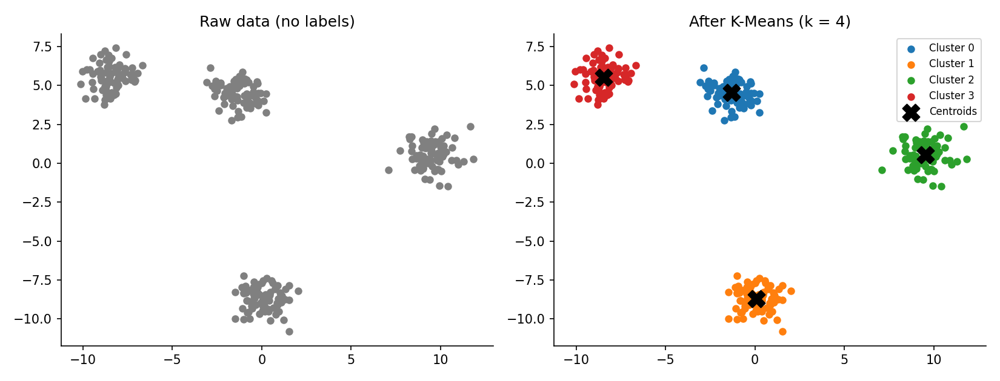
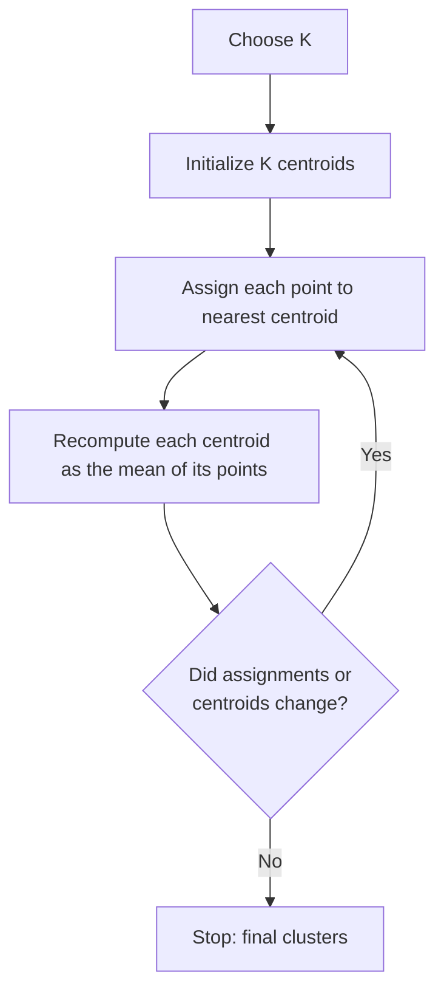
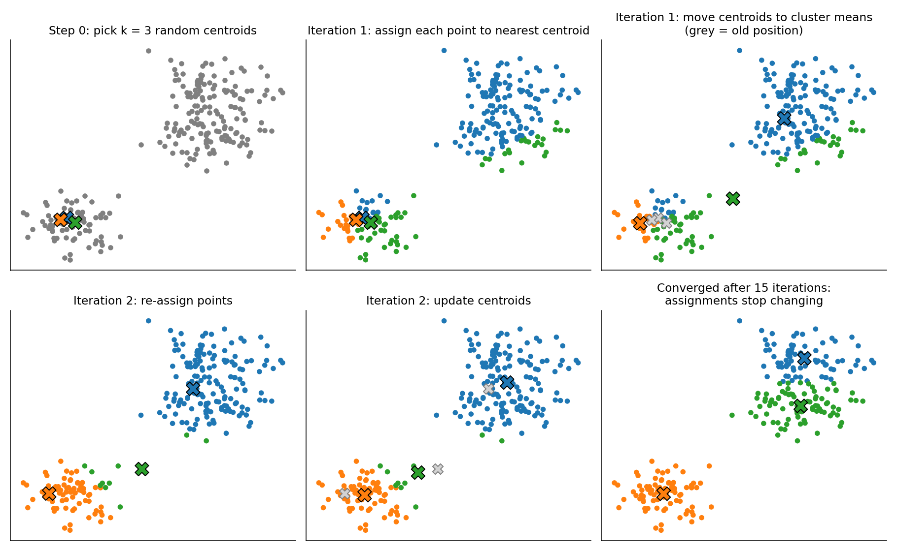
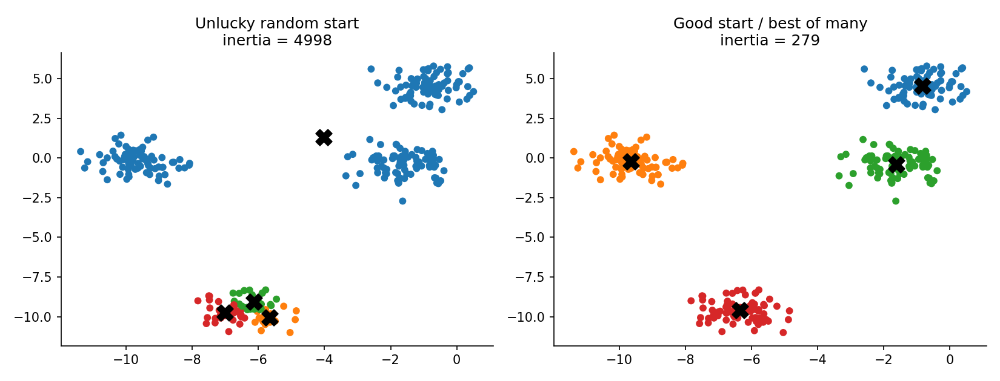
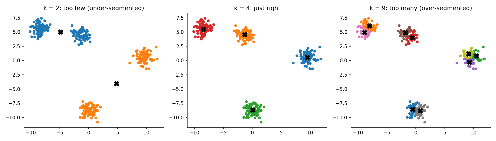
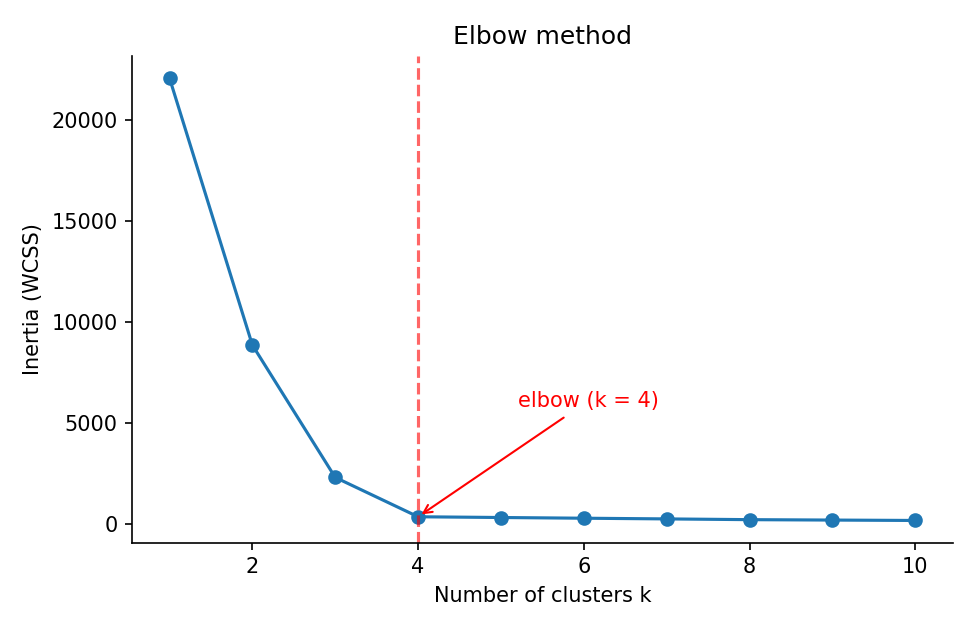
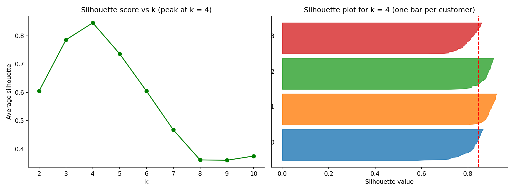
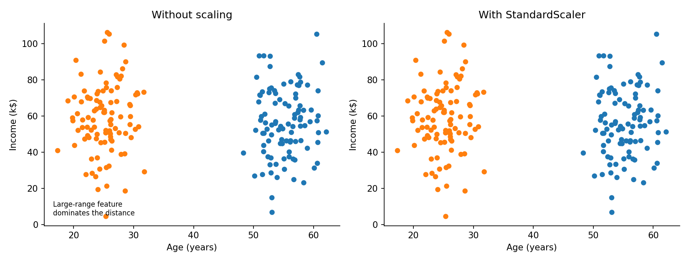
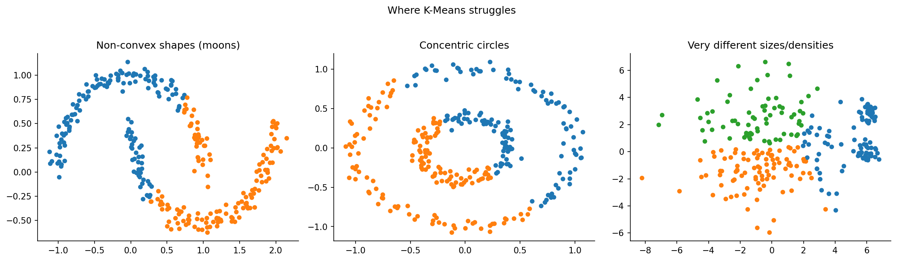
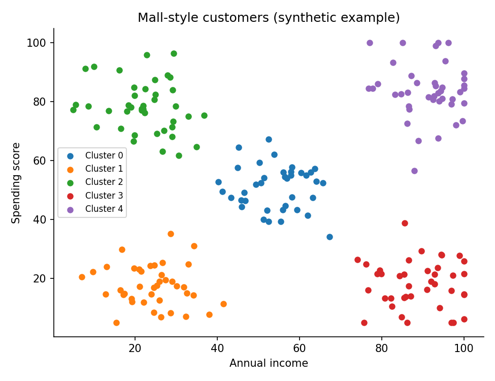

# K-Means Clustering: A Complete Guide

A detailed, beginner-friendly guide to K-Means, from the basic idea to evaluation, limitations and a real marketing use case (Mall Customer Segmentation).

> **Note:** All figures in this guide are in the `figures/` folder next to this file. They are illustrative examples on synthetic data, not the results of your own dataset.

---

## Table of Contents

1. [What is Clustering?](#1-what-is-clustering)
2. [What is K-Means?](#2-what-is-k-means)
3. [How the Algorithm Works](#3-how-the-algorithm-works)
4. [The Mathematics Behind It](#4-the-mathematics-behind-it)
5. [Initialization and K-Means++](#5-initialization-and-k-means)
6. [Choosing the Number of Clusters (k)](#6-choosing-the-number-of-clusters-k)
7. [Data Preparation](#7-data-preparation)
8. [Evaluating Cluster Quality](#8-evaluating-cluster-quality)
9. [Assumptions and Limitations](#9-assumptions-and-limitations)
10. [Variants and Alternatives](#10-variants-and-alternatives)
11. [K-Means in Python (scikit-learn)](#11-k-means-in-python-scikit-learn)
12. [Case Study: Mall Customer Segmentation](#12-case-study-mall-customer-segmentation)
13. [Advantages and Disadvantages](#13-advantages-and-disadvantages)
14. [Common Mistakes](#14-common-mistakes)
15. [Interview Questions and Short Answers](#15-interview-questions-and-short-answers)
16. [Glossary](#16-glossary)

---

## 1. What is Clustering?

**Clustering** is a type of **unsupervised learning**. We have data but **no labels** (no "correct answer"). The goal is to automatically find natural groups (clusters) so that:

- items in the **same group are similar** to each other, and
- items in **different groups are different** from each other.

| Supervised learning | Unsupervised learning |
|---|---|
| Data has labels (e.g. spam / not spam) | Data has no labels |
| Goal: predict the label | Goal: discover structure |
| Evaluated with accuracy, F1, etc. | Evaluated with cluster quality metrics |
| Examples: classification, regression | Examples: clustering, dimensionality reduction |

**Real-life uses of clustering:** customer segmentation, grouping news articles, image compression, anomaly detection, document organization, and recommendation systems.

---

## 2. What is K-Means?

**K-Means** is one of the simplest and most popular clustering algorithms. It splits the data into **K groups**, where each group is represented by its **centroid** (the mean/center of all its points).



*Left: raw data with no labels. Right: K-Means has grouped the points into 4 clusters, each with a centroid (black X).*

**Key terms**

- **K**: number of clusters you want (you choose it).
- **Centroid**: the center point of a cluster (the average of all points in it).
- **Inertia / WCSS**: total squared distance of points from their own centroid. It measures how compact the clusters are.

**Core idea in one line:** every point belongs to the cluster whose centroid is closest to it, and every centroid is the average of the points that belong to it.

---

## 3. How the Algorithm Works

K-Means uses an iterative method known as **Lloyd's algorithm**.



**Step by step**

1. **Choose K**, the number of clusters.
2. **Initialize** K centroids (random points from the data, or smarter, see K-Means++).
3. **Assignment step:** for each data point, calculate the distance to every centroid and assign the point to the nearest one.
4. **Update step:** move each centroid to the mean of all points assigned to it.
5. **Repeat** steps 3 and 4 until the assignments stop changing (convergence) or a maximum number of iterations is reached.



*The algorithm in action: random starting centroids, then repeated assign-and-update steps until the centroids settle.*

**Tiny numeric example (1D)**

Points: 1, 2, 3, 10, 11, 12 and K = 2. Start with centroids 1 and 12.

- Assign: {1, 2, 3} go to centroid 1 and {10, 11, 12} go to centroid 12.
- Update: new centroids are mean(1, 2, 3) = 2 and mean(10, 11, 12) = 11.
- Assign again: nothing changes, so the algorithm stops. Final clusters: {1, 2, 3} and {10, 11, 12}.

---

## 4. The Mathematics Behind It

**Distance used:** Euclidean distance between a point $x$ and a centroid $\mu$:

$$d(x, \mu) = \sqrt{\sum_{j=1}^{n} (x_j - \mu_j)^2}$$

**Objective function:** K-Means tries to minimize the **within-cluster sum of squares (WCSS)**, also called **inertia**:

$$J = \sum_{i=1}^{K} \sum_{x \in C_i} \lVert x - \mu_i \rVert^2$$

where $C_i$ is cluster $i$ and $\mu_i$ is its centroid.

**Centroid update rule:**

$$\mu_i = \frac{1}{|C_i|} \sum_{x \in C_i} x$$

**Convergence:** each assignment step and each update step can only keep $J$ the same or lower it. Since there are a finite number of possible assignments, the algorithm always converges. However, it converges to a **local minimum**, not always the global best (see the next section).

**Complexity:** roughly $O(n \cdot K \cdot d \cdot I)$, where $n$ is the number of points, $d$ the number of features and $I$ the number of iterations. This is why K-Means is fast even for large datasets.

---

## 5. Initialization and K-Means++

The result depends on where the centroids start. A bad random start can give a **poor local minimum**.



*Same data, same K, different random starts: the left run ends with a much higher inertia (worse clustering) than the right one.*

**Solutions**

- **`n_init`:** run K-Means several times with different starts and keep the run with the lowest inertia (scikit-learn default is `auto`; many people set `n_init=10`).
- **K-Means++ (default `init="k-means++"` in scikit-learn):** picks the first centroid randomly, then chooses each next centroid with probability proportional to its squared distance from the nearest centroid already chosen. This spreads the starting centroids out and usually gives better, more stable results.
- **`random_state`:** fixes the random seed so your results are reproducible.

---

## 6. Choosing the Number of Clusters (k)

K must be chosen **before** running the algorithm. Too few clusters merge different groups. Too many split natural groups into meaningless pieces.



*The same data with k = 2 (too few), k = 4 (appropriate) and k = 9 (too many).*

### 6.1 Elbow Method

1. Run K-Means for k = 1, 2, 3, ... 10.
2. Plot **inertia** against k.
3. Pick the k at the **"elbow"**, where the curve stops dropping sharply and starts to flatten.



*Inertia always decreases as k grows (with k = n it would be zero), so we look for the point of diminishing returns, not the minimum.*

**Limitation:** the elbow is sometimes not sharp, and different people may pick different points. Combine it with the silhouette score.

### 6.2 Silhouette Score

For each point:

$$s = \frac{b - a}{\max(a, b)}$$

- $a$ = average distance to the other points in its **own** cluster
- $b$ = average distance to the points in the **nearest other** cluster

The value is between -1 and 1:

| Silhouette | Meaning |
|---|---|
| Close to 1 | Point is well inside its cluster |
| Around 0 | Point is on the border between two clusters |
| Negative | Point is probably in the wrong cluster |

The **average silhouette score** is plotted against k, and the k with the **highest** score is preferred.



*Left: average silhouette versus k. Right: per-customer silhouette values for k = 4. Wide, uniform bars mean well-formed clusters. The red dashed line is the average.*

**Rough interpretation of the average score:** above 0.5 is strong, 0.25 to 0.5 is reasonable, and below 0.25 is weak structure.

### 6.3 Other Methods

- **Davies-Bouldin Index:** average similarity between each cluster and its most similar cluster. **Lower is better.**
- **Calinski-Harabasz Index:** ratio of between-cluster spread to within-cluster spread. **Higher is better.**
- **Gap statistic:** compares inertia with what you would expect from random data.
- **Business sense:** in marketing, a segmentation is only useful if each segment is interpretable and can be treated differently. Sometimes you choose a slightly lower-scoring k because the segments are more actionable.

**Best practice:** use the elbow and silhouette together, and then check that the resulting clusters make business sense.

---

## 7. Data Preparation

### 7.1 Feature Scaling (very important)

K-Means is **distance-based**. A feature with a larger numeric range (for example income in thousands) will dominate a feature with a small range (for example age), even if age is just as important.



*Without scaling, the clustering is driven almost entirely by the large-range feature. After `StandardScaler`, both features count.*

Common scalers:

- **StandardScaler:** $z = \frac{x - \text{mean}}{\text{std}}$ (mean 0, std 1). Most common choice for K-Means.
- **MinMaxScaler:** rescales values to the 0 to 1 range.

### 7.2 Categorical Features

K-Means uses means and Euclidean distance, so it works best with **numeric** data.

- Binary columns like Gender can be encoded as 0/1, but plain K-Means is not ideal for them.
- Often it is better to **leave categorical columns out of the clustering** and use them only when **profiling** the clusters.
- For mixed data, use **K-Modes** or **K-Prototypes**.

### 7.3 Outliers and Missing Values

- Centroids are means, so a few extreme outliers can drag a centroid away from the true center. Check for and handle outliers first.
- Remove or fill missing values before clustering, since K-Means cannot handle them.
- Drop identifier columns such as `CustomerID`. They carry no meaning for similarity.

### 7.4 Too Many Features

With many features, distances become less meaningful ("curse of dimensionality"). Consider **PCA** first, or select only the relevant features. PCA is also useful for visualizing clusters in 2D.

---

## 8. Evaluating Cluster Quality

Accuracy cannot be used because there are no true labels. Instead we use:

| Metric | Better when | What it tells you |
|---|---|---|
| **Inertia (WCSS)** | Lower | Compactness. Only comparable for the same k (always falls as k rises) |
| **Silhouette Score** | Higher (max 1) | Cohesion and separation together |
| **Davies-Bouldin Index** | Lower (min 0) | Overlap between clusters. Below 1 is considered good |
| **Calinski-Harabasz Index** | Higher | Ratio of between-cluster to within-cluster variance |
| **Adjusted Rand Index** | Higher | Only if true labels exist, or to compare two runs for stability |

**Stability check:** run the model with different `random_state` values. If the clusters are nearly the same each time, the segmentation is stable.

**Profiling:** after clustering, compute the average of each feature per cluster and interpret what makes each group different. This is the step that turns clusters into business value.

---

## 9. Assumptions and Limitations

K-Means implicitly assumes clusters are:

- **roughly spherical** (round, not elongated or curved),
- **similar in size and density**,
- **separable by distance to a center.**

When these assumptions are broken, results can be misleading.



*K-Means cuts the moons and the concentric circles with straight boundaries, and it splits the large cluster instead of respecting the small dense ones.*

Other limitations:

- You must choose **K** in advance.
- Sensitive to **initialization** (local minima) and to **outliers**.
- Every point is forced into a cluster, even noise.
- Gives **hard assignments** only (no probabilities).
- Works with numeric data and needs **scaling**.

---

## 10. Variants and Alternatives

| Method | When to use it |
|---|---|
| **K-Means++** | Better initialization (already the default in scikit-learn) |
| **Mini-Batch K-Means** | Very large datasets. Uses small random batches, which is much faster |
| **K-Medoids (PAM)** | More robust to outliers. Centers are real data points |
| **K-Modes / K-Prototypes** | Categorical or mixed data |
| **Gaussian Mixture Model (GMM)** | Elliptical clusters and soft (probabilistic) assignments |
| **Hierarchical (Agglomerative)** | You want a dendrogram, or do not want to fix K up front |
| **DBSCAN / HDBSCAN** | Arbitrary shapes, noise and outlier detection, unknown K |
| **Spectral Clustering** | Non-convex clusters connected by graph structure |

---

## 11. K-Means in Python (scikit-learn)

**Minimal example**

```python
from sklearn.cluster import KMeans
from sklearn.preprocessing import StandardScaler

X_scaled = StandardScaler().fit_transform(X)

kmeans = KMeans(n_clusters=4, init="k-means++", n_init=10, random_state=42)
labels = kmeans.fit_predict(X_scaled)

print(kmeans.cluster_centers_)   # centroids (in scaled space)
print(kmeans.inertia_)           # WCSS
```

**Elbow and silhouette loop**

```python
from sklearn.metrics import silhouette_score

inertias, sil = [], []
for k in range(2, 11):
    km = KMeans(n_clusters=k, n_init=10, random_state=42)
    lab = km.fit_predict(X_scaled)
    inertias.append(km.inertia_)
    sil.append(silhouette_score(X_scaled, lab))
```

**Important parameters**

| Parameter | Meaning |
|---|---|
| `n_clusters` | Number of clusters K |
| `init` | `"k-means++"` (default) or `"random"` |
| `n_init` | Number of different initializations to try. Best run is kept |
| `max_iter` | Maximum iterations per run (default 300) |
| `tol` | Convergence tolerance |
| `random_state` | Seed for reproducible results |

**Important attributes**

- `labels_`: cluster number of each sample
- `cluster_centers_`: coordinates of the centroids
- `inertia_`: final WCSS
- `n_iter_`: iterations used

**Predicting new customers:** `kmeans.predict(scaler.transform(new_data))`. Always apply the **same fitted scaler** to new data.

---

## 12. Case Study: Mall Customer Segmentation

**Problem:** a mall wants to group its customers to design targeted marketing.

**Dataset columns:** `CustomerID`, `Genre` (gender), `Age`, `Annual Income (k$)`, `Spending Score (1-100)`. About 200 customers.

**Pipeline**

1. **Clean:** check missing values and duplicates, rename columns (`Income`, `SpendingScore`, `Gender`).
2. **Select features:** `Age`, `Income`, `SpendingScore`. `CustomerID` is dropped, and Gender is kept only for profiling.
3. **Scale:** `StandardScaler`, because age (about 18 to 70) and income (about 15 to 137) have different ranges.
4. **Choose k:** the elbow bends between k = 4 and 6 and the silhouette score peaks at **k = 6** (about 0.43).
5. **Fit K-Means** with k = 6 and save the labels.
6. **Visualize:** 3D scatter, PCA 2D scatter, Income vs Spending Score.
7. **Profile:** average age, income, spending score, size and gender ratio per cluster.
8. **Act:** derive marketing actions for each segment.
9. **Evaluate:** Silhouette 0.428, Davies-Bouldin 0.825, Calinski-Harabasz 135.1.



*Synthetic illustration of the classic Mall Customers view (Income vs Spending Score). Typical segments appear in different corners of the plot.*

**Typical segment types and marketing actions**

| Segment type | Behaviour | Marketing action |
|---|---|---|
| High income, high spending | Best customers | VIP / loyalty programme, premium launches, early access |
| High income, low spending | Untapped potential | Personalized premium offers, exclusive events to raise engagement |
| Low income, high spending | Enthusiastic but price-sensitive | Discounts, installment or cashback offers, bundle deals |
| Low income, low spending | Low priority | Low-cost coupons, seasonal sales only |
| Mid income, mid spending | Average shoppers | Cross-sell and upsell, rewards that nudge spending upward |
| Young segments | Trend driven | Social media, events, trendy brands |
| Older segments | Value and comfort driven | Email/SMS, value-focused messaging |

**Evaluation summary for the project**

- **Silhouette = 0.428:** reasonably well-separated clusters.
- **Davies-Bouldin = 0.825:** below 1, so clusters are compact with limited overlap.
- **Calinski-Harabasz = 135.1:** mainly useful for comparing different models or k values.

---

## 13. Advantages and Disadvantages

| Advantages | Disadvantages |
|---|---|
| Simple and easy to understand | Must choose K in advance |
| Fast and scales to large datasets | Sensitive to initialization and outliers |
| Works well on compact, round clusters | Poor on non-spherical or unequal-density clusters |
| Easy to interpret via centroids | Only numeric data, needs scaling |
| Guaranteed to converge | Converges to local minimum, not always global |
| Easy to implement (scikit-learn) | Hard assignments only |

---

## 14. Common Mistakes

1. **Forgetting to scale** the features.
2. **Including ID columns** (like `CustomerID`) in the clustering.
3. **Choosing k only from the elbow** when the elbow is unclear. Use silhouette and business sense too.
4. **Treating inertia as a quality score across different k.** It always decreases as k rises.
5. **Ignoring outliers**, which pull centroids away.
6. **Using K-Means on categorical data** without proper encoding or a better algorithm.
7. **Not setting `random_state` / `n_init`**, which leads to unstable, non-reproducible results.
8. **Stopping at the labels.** Without profiling, clusters are just numbers.
9. **Expecting "accuracy".** K-Means is unsupervised, so use cluster-quality metrics.

---

## 15. Interview Questions and Short Answers

**Q1. Is K-Means supervised or unsupervised?**
Unsupervised. It needs no labels.

**Q2. What does K-Means minimize?**
The within-cluster sum of squared distances (WCSS or inertia).

**Q3. How do you choose k?**
Elbow method, silhouette score (plus Davies-Bouldin / Calinski-Harabasz), and business interpretability.

**Q4. Why scale the data?**
Because K-Means uses Euclidean distance, so large-range features would dominate.

**Q5. What is K-Means++?**
A smart initialization that spreads the starting centroids apart, giving better and more stable results.

**Q6. Does K-Means always find the best clustering?**
No. It converges to a local minimum, which is why we use several initializations (`n_init`).

**Q7. What are the limitations?**
Needs k in advance, assumes round and similar-sized clusters, sensitive to outliers, numeric data only.

**Q8. How do you evaluate it without labels?**
Silhouette score, Davies-Bouldin, Calinski-Harabasz, stability across runs and profiling.

**Q9. What is the difference between K-Means and hierarchical clustering?**
K-Means needs k up front and is fast. Hierarchical builds a tree (dendrogram) and lets you choose the number of clusters afterwards but is slower on large data.

**Q10. What would you use for clusters of arbitrary shape?**
DBSCAN, HDBSCAN or spectral clustering.

---

## 16. Glossary

| Term | Meaning |
|---|---|
| **Cluster** | A group of similar data points |
| **Centroid** | Center (mean) of a cluster |
| **Inertia / WCSS** | Sum of squared distances of points to their centroid |
| **Elbow method** | Plot of inertia against k to find the point of diminishing returns |
| **Silhouette score** | Measure of how well each point fits its own cluster compared to others |
| **Convergence** | State when assignments stop changing |
| **Local minimum** | A good but not necessarily the best solution |
| **K-Means++** | Smart centroid initialization |
| **Scaling** | Bringing features to a comparable range |
| **PCA** | Dimensionality reduction technique, often used to visualize clusters in 2D |
| **Profiling** | Describing each cluster using the average values of its features |
| **Segmentation** | Dividing customers into groups for targeted marketing |

---

*End of guide.*
